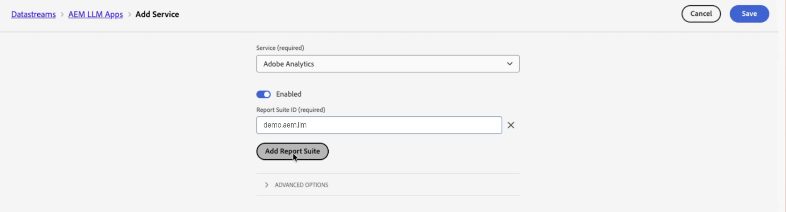
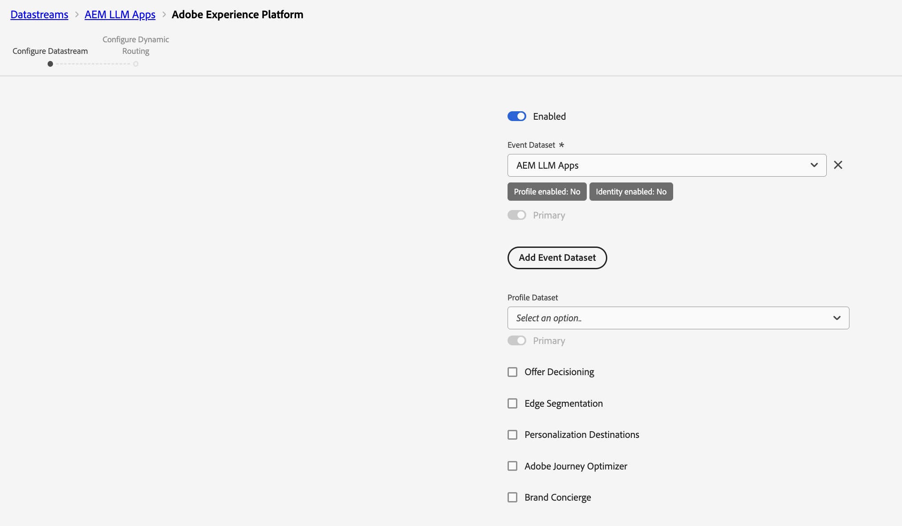
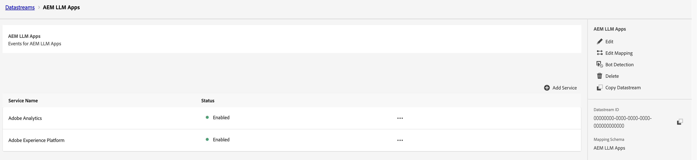
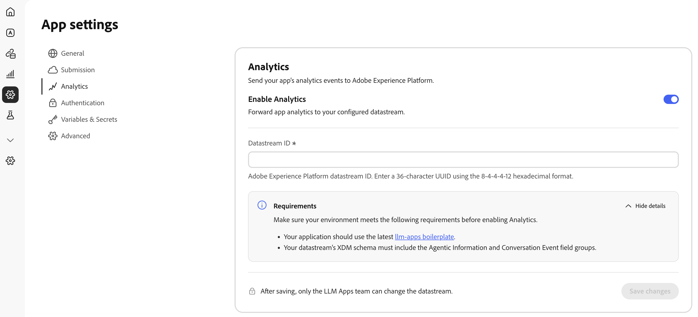

# Configurer Adobe Analytics et Customer Journey Analytics {#analytics-setup}

>[!IMPORTANT]
>
>Les applications LLM sont disponibles pour tous les clients AEM Sites Cloud Service afin qu’ils puissent développer et gérer leurs propres applications. Une fois le comptage commencé, chaque appel d’application est comptabilisé dans les demandes de contenu AEM Sites du client. Adobe annoncera le taux de contrôle et la date de début avant que le contrôle ne prenne effet.

Envoyez les événements de votre application à [!DNL Adobe Analytics], [!DNL Customer Journey Analytics] ou les deux. [!DNL LLM Apps] transfère les événements vers [!DNL Adobe Experience Platform] Edge Network par le biais d’un flux de données que vous détenez. Le flux de données achemine les événements vers chaque service que vous lui ajoutez.

- **[!DNL Adobe Analytics]** indique les actions que la plateforme LLM appelle, les liens de widget que les personnes sélectionnent et l’intention derrière chaque appel.
- **[!DNL Customer Journey Analytics]** analyse les mêmes événements par personne, dans les vues de données que vous créez sur [!DNL Experience Platform] données.

Cette configuration est distincte des analyses intégrées dans [!DNL LLM Apps].

**Dans ce guide :** Découvrez les paramètres [!DNL LLM Apps] requis dans [!DNL Experience Platform], [!DNL Adobe Analytics] et [!DNL Customer Journey Analytics], avec des liens vers la procédure Experience League pour chaque écran de produit. Ensuite, activez Analytics dans votre application, déployez-la dans l’environnement intermédiaire et vérifiez les données avant de la déployer dans l’environnement de production.

## Liste de contrôle de configuration {#setup-checklist}

Terminez chaque étape marquée **Requise** pour les services que vous utilisez. Une étape ignorée affiche rarement une erreur. Au lieu de cela, les données n’arrivent pas.

| Étape | [!DNL Adobe Analytics] | [!DNL Customer Journey Analytics] |
|---|---|---|
| [1. Créer l&#39;espace de noms d&#39;identité](#identity-namespace) | Requis | Requis |
| [2. Créer le schéma](#schema) | Requis | Requis |
| [3. Créer le jeu de données &#x200B;](#dataset) | Pas nécessaire | Requis |
| [4. Préparer la suite de rapports](#report-suite) | Requis | Pas nécessaire |
| [5. Créer le flux de données &#x200B;](#datastream) | Requis | Requis |
| [6. Activer Analytics et déployer dans l’environnement intermédiaire](#enable-analytics) | Requis | Requis |
| [7. Créer la connexion et la vue de données &#x200B;](#cja) | Pas nécessaire | Requis |
| [8. Vérifier les données et les déployer en production &#x200B;](#verify) | Requis | Requis |

Créez l’espace de noms, le schéma, le jeu de données et le flux de données dans le même sandbox [!DNL Experience Platform]. Utilisez le sandbox et le flux de données à partir desquels vous prévoyez de créer des rapports en production. Après avoir enregistré le flux de données dans votre application, contactez l’équipe applications LLM pour le modifier.

## Avant de commencer {#before-you-begin}

Vous avez besoin des éléments suivants :

- **Un runtime et SDK pris en charge.** Votre référentiel de gestionnaire doit utiliser `@adobe/llm-apps-runtime` version 1.2.0 ou ultérieure. Pour les widgets EDS, utilisez LLM Apps SDK 0.1.13 ou une version ultérieure. Pour mettre à jour une ancienne application vers le dernier runtime et SDK avant d’activer Analytics, suivez [Mettre à niveau une application existante](/help/guides/upgrade-existing-app.md). Les applications qui répondent à ces exigences n’ont pas besoin d’être mises à niveau.
- **Groupes de champs agentic.** Votre organisation doit être activée pour les groupes de champs Informations sur l’agence et Événement de conversation . Si ces groupes de champs n’apparaissent pas lorsque vous ajoutez des groupes de champs à un schéma, contactez votre équipe de compte Adobe. Voir [Implémenter Des Informations Sur Les Conversations](https://experienceleague.adobe.com/fr/docs/analytics-platform/using/conversation-insights/implement#schema-and-datasets). Les appels à l’action sont enregistrés dans le champ `agenticExperience.tools` des Informations agences, qui se trouve dans Beta dans [!DNL Experience Platform].
- **[!DNL Experience Platform]autorisations** pour créer des espaces de noms d’identité, des schémas, des jeux de données et des flux de données dans votre sandbox.
- **Pour [!DNL Adobe Analytics] :** autorisation de gérer les suites de rapports et les règles de traitement. Les administrateurs de produit disposent des deux par défaut.
- **Pour [!DNL Customer Journey Analytics] :** accès administrateur de produit pour créer des connexions et des vues de données.

## Ce que votre application envoie {#what-your-app-sends}

Après avoir activé Analytics et déployé, votre application envoie deux types d’événements :

| Événement | `eventType` | Envoyé lorsque | Inclut |
|---|---|---|---|
| Appel d&#39;action | `mcp.tool_call` | La plateforme LLM appelle l’une des actions de votre application, y compris les appels qui échouent ou renvoient une invite de connexion. | Identifiant du code de l’action et si l’appel a échoué. Intention de l’utilisateur ou de l’utilisatrice, lorsque l’action la collecte et que la plateforme en fournit une. Lorsque la plateforme les fournit : le nom de la plateforme, l’ID de conversation, l’ID utilisateur de la plateforme, les paramètres régionaux et l’organisation, ainsi que l’emplacement approximatif de l’utilisateur. |
| Interaction du widget | `web.webinteraction.linkClicks` | Quelqu’un sélectionne un lien ou un bouton dans un widget Edge Delivery Services. | Libellé du lien ou du bouton (100 caractères maximum). Lorsqu’il est fourni par l’appel d’action, son identifiant de conversation et son identifiant de tournant. Adobe Web SDK ajoute également l’URL du cadre du widget, la taille de la fenêtre de l’écran et du navigateur, l’heure et le fuseau horaire locaux, ainsi que sa propre version. |

Dans [!DNL Adobe Analytics], chaque appel d’action est comptabilisé comme une page vue d’une page nommée `mcp:<code identifier>` et chaque interaction de widget est comptabilisée comme un clic sur le lien. Voir [Types d’événements Edge Network dans Adobe Analytics](https://experienceleague.adobe.com/fr/docs/analytics/implementation/aep-edge/hit-types).

Chaque appel d’action et chaque interaction de widget est un accès [!DNL Adobe Analytics] et un événement dans votre jeu de données [!DNL Experience Platform]. Sur une application à trafic élevé, vérifiez que votre contrat couvre ce volume avant d’activer Analytics.

Gardez ces détails à l’esprit lorsque vous lisez les rapports :

- **Les appels ayant échoué incluent des invites de connexion.** Si certaines actions nécessitent une connexion, attendez-vous à un taux d’échec plus élevé.
- **Certains appels rejetés ne sont pas enregistrés.** Un appel est rejeté avant l&#39;exécution de l&#39;action et n&#39;envoie aucun événement lorsqu&#39;une plateforme autre que [!DNL ChatGPT] appelle une action nécessitant une connexion sans connexion valide ou sans portée requise. Sur les applications où chaque action nécessite une connexion, tout appel sans connexion est rejeté de la même manière.
- **L’intention de l’utilisateur est souvent absente.** La plateforme décide de la fournir ou non. Par conséquent, de nombreux appels n’en comportent aucun et apparaissent comme **Non spécifié**.
- **Les détails de la plateforme varient.** Actuellement, [!DNL ChatGPT] les fournit tous. Pour [!DNL Claude], seul le nom de la plateforme est enregistré.
- **Les libellés de widget proviennent de la page.** Pour définir un libellé stable, ajoutez un attribut `data-analytics` au lien ou au bouton. Dans le cas contraire, son texte visible est utilisé.

Pour choisir les actions qui collectent l’intention de l’utilisateur, consultez [Configurer les analyses](/help/guides/create-action.md#configure-analytics).

>[!NOTE]
>
>Les événements peuvent inclure un identifiant utilisateur de plateforme et un emplacement approximatif. Consultez votre politique de confidentialité et les paramètres de gouvernance des données avant d’activer Analytics.

### Comment les événements identifient les personnes {#identities}

| Événement | Identité du Principal | Espace de noms |
|---|---|---|
| Appel d&#39;action | ID utilisateur de la plateforme LLM, lorsque la plateforme en fournit un | `MCPHOSTUSER` |
| Interaction du widget | Identifiant Experience Cloud (ECID) émis par Edge Network lors de l’appel d’action. L’identifiant `MCPHOSTUSER` est inclus en tant qu’identité secondaire lorsqu’il est disponible. | `ECID` |

Certaines plateformes, telles que [!DNL Claude], ne fournissent pas d&#39;ID utilisateur. Les appels d&#39;action de ces plateformes n&#39;ayant aucune identité, [!DNL Customer Journey Analytics] les ignore.

>[!NOTE]
>
>Chaque appel d’action obtient un nouvel ECID, et une interaction de widget utilise l’ECID de l’appel d’action qui a affiché le widget. Par conséquent :
>
>- [!DNL Customer Journey Analytics] compte les appels d&#39;action d&#39;un utilisateur comme une seule personne, mais compte ses interactions de widget comme une personne différente pour chaque appel d&#39;action.
>- [!DNL Adobe Analytics] peut comptabiliser chaque appel d&#39;action comme un nouveau visiteur.

## Étape 1 : créer l’espace de noms d’identité {#identity-namespace}

**Requis pour :** [!DNL Adobe Analytics] et [!DNL Customer Journey Analytics].

Les appels d’action identifient des personnes dans l’espace de noms `MCPHOSTUSER`. L’espace de noms doit donc exister dans votre sandbox. Créez un espace de noms personnalisé avec les paramètres suivants :

| Configuration | Valeur |
|---|---|
| Nom d’affichage | `MCP host user` ou un autre nom de votre choix |
| Symbole d’identité | `MCPHOSTUSER`, exactement comme indiqué |
| Type d’identité | **[!UICONTROL Identifiant individuel sur l’ensemble des appareils]** |

Pour la procédure, voir [Création d’espaces de noms personnalisés](https://experienceleague.adobe.com/fr/docs/experience-platform/identity/features/namespaces#create-namespaces).

## Étape 2 : créer le schéma {#schema}

**Requis pour :** [!DNL Adobe Analytics] et [!DNL Customer Journey Analytics].

Le flux de données et le jeu de données utilisent tous deux ce schéma. Créez un schéma avec les paramètres suivants :

| Configuration | Valeur |
|---|---|
| Type de schéma | **[!UICONTROL Standard]**, créé avec l&#39;option **[!UICONTROL Manuel]** |
| Classe de base | **[!UICONTROL Événement D’Expérience]** |
| Groupes de champs | Informations sur l’agence, événement de conversation, détails web, détails de l’environnement et détails d’implémentation |
| Nom d’affichage | Tout nom, par exemple `AEM LLM Apps` |

>[!IMPORTANT]
>
>Ajoutez les cinq groupes de champs . [!DNL LLM Apps] nécessite des informations sur l&#39;agent et un événement de conversation pour les appels d&#39;action. Les trois autres contiennent les champs de page, de lien, d’appareil, d’environnement et d’implémentation que les événements incluent également. Si un groupe de champs est manquant, [!DNL Experience Platform] peut supprimer ces champs ou rejeter l’événement.

Vous n’avez pas besoin du groupe de champs Adobe Analytics ExperienceEvent. L’intention de l’utilisateur atteint [!DNL Adobe Analytics] via une règle de traitement à la place. Voir [Étape 4](#report-suite).

Pour la procédure, voir [Créer un schéma](https://experienceleague.adobe.com/fr/docs/experience-platform/xdm/ui/resources/schemas#create) et [Ajouter des groupes de champs](https://experienceleague.adobe.com/fr/docs/experience-platform/xdm/ui/resources/schemas#add-field-groups).

## Étape 3 : créer le jeu de données {#dataset}

**Requis pour :** [!DNL Customer Journey Analytics].

Le jeu de données stocke les événements de votre application dans [!DNL Experience Platform]. Créez un jeu de données avec les paramètres suivants :

| Configuration | Valeur |
|---|---|
| Méthode de création | **[!UICONTROL Créer un jeu de données à partir d&#39;un schéma]** |
| Schéma | Le schéma de [Étape 2](#schema) |
| Nom | Tout nom, par exemple `AEM LLM Apps` |

Pour la procédure, voir [Créer un jeu de données](https://experienceleague.adobe.com/fr/docs/experience-platform/catalog/datasets/user-guide#create).

## Étape 4 : préparation de la suite de rapports {#report-suite}

**Requis pour :** [!DNL Adobe Analytics].

[!DNL Adobe Analytics] mappe automatiquement le nom de la page et les champs de lien, de sorte que les pages `mcp:<code identifier>` et les clics sur les liens des widgets n’aient pas besoin d’être configurés en plus. L’intention de l’utilisateur a besoin d’une eVar et d’une règle de traitement.

### Créer ou choisir une suite de rapports {#create-report-suite}

Créez une suite de rapports ou choisissez-en une existante. Notez l’identifiant complet de la suite de rapports, y compris le préfixe ajouté par [!DNL Adobe Analytics]. Vous avez besoin de l’identifiant à l’[étape 5](#datastream).

Pour la procédure, voir [Créer une suite de rapports](https://experienceleague.adobe.com/fr/docs/analytics/admin/admin-tools/manage-report-suites/c-new-report-suite/t-create-a-report-suite).

### Activation de l’eVar des intentions de l’utilisateur {#user-intent-evar}

Dans les variables de conversion de la suite de rapports, activez une eVar avec les paramètres suivants :

| Configuration | Valeur |
|---|---|
| eVar | eVar3 |
| Nom | `User Intent` |
| Type | **[!UICONTROL Chaîne De Texte]** |
| Allocation | **[!UICONTROL La Plus Récente (Dernière)]** |
| Expire après | **[!UICONTROL Visite]** |
| Statut | **[!UICONTROL Activé]** |

Si la suite de rapports utilise déjà eVar3, choisissez une autre eVar inutilisée et utilisez cette eVar dans la règle de traitement.

Pour la procédure, voir [Ajouter ou modifier des variables de conversion](https://experienceleague.adobe.com/fr/docs/analytics/admin/admin-tools/manage-report-suites/edit-report-suite/conversion-variables/conversion-var-admin#add-or-edit-conversion-variables).

### Création de la règle de traitement {#processing-rule}

[!DNL Adobe Analytics] reçoit l&#39;intention de l&#39;utilisateur sous la forme d&#39;une variable de données contextuelles, et non d&#39;une eVar. Pour en savoir plus, consultez [Mappage implicite](https://experienceleague.adobe.com/fr/docs/analytics/implementation/aep-edge/xdm-var-mapping#implicit-mapping). Créez une règle de traitement qui copie l’intention de l’utilisateur dans eVar :

- **Condition :** la variable de données contextuelles `a.x.conversation.prompt.raw.0.purpose` est égale à `intents`.
- **Action :** remplacez la valeur de **Intention de l’utilisateur (eVar3)** par la variable de données contextuelles `a.x.conversation.prompt.raw.0.text`.

Sans cette règle, la dimension **Intention de l’utilisateur** reste vide. La règle s’applique uniquement aux données collectées après leur enregistrement. Les interactions de widget ne comportent aucune intention de l’utilisateur, la règle ne les modifie donc pas.

D’autres champs, tels que l’échec de l’appel ou le nom de la plateforme, arrivent également en tant que variables de données contextuelles. Pour créer des rapports à leur sujet dans [!DNL Adobe Analytics], créez d’autres règles de traitement de la même manière.

Pour la procédure, voir [Présentation des règles de traitement](https://experienceleague.adobe.com/fr/docs/analytics/admin/admin-tools/manage-report-suites/edit-report-suite/report-suite-general/processing-rules/pr-overview) et [Cas d’utilisation des règles de traitement](https://experienceleague.adobe.com/fr/docs/analytics/admin/admin-tools/manage-report-suites/edit-report-suite/report-suite-general/processing-rules/pr-use-cases).

## Étape 5 : créer le flux de données {#datastream}

**Requis pour :** [!DNL Adobe Analytics] et [!DNL Customer Journey Analytics].

Le flux de données reçoit les événements de votre application et les transfère à chaque service que vous ajoutez.

### Créer le flux de données {#create-datastream}

Créez un flux de données avec les paramètres suivants :

| Configuration | Valeur |
|---|---|
| Nom | Tout nom, par exemple `AEM LLM Apps` |
| Schéma de mapping | Le schéma de [Étape 2](#schema) |

Créez le flux de données dans le même sandbox que le schéma. Vous ne pouvez pas modifier le sandbox d’un flux de données après l’avoir créé.

Pour la procédure, voir [Créer un flux de données](https://experienceleague.adobe.com/fr/docs/experience-platform/datastreams/configure#create).

### Ajouter les services {#add-services}

Ajoutez un service pour chaque destination :

| Service | Paramètres | Obligatoire pour |
|---|---|---|
| **[!UICONTROL Adobe Analytics]** | **[!UICONTROL Activé]**. Dans **[!UICONTROL Identifiant de suite de rapports]**, saisissez l’identifiant à partir de [Étape 4](#report-suite). | [!DNL Adobe Analytics] |
| **[!UICONTROL Adobe Experience Platform]** | **[!UICONTROL Activé]**. Dans le **[!UICONTROL jeu de données d’événement]**, sélectionnez le jeu de données à partir de l’[Étape 3](#dataset). Laissez les autres options désactivées. | [!DNL Customer Journey Analytics] |

Pour la procédure, voir [Ajouter des services à un flux de données](https://experienceleague.adobe.com/fr/docs/experience-platform/datastreams/configure#add-services), [Paramètres Adobe Analytics](https://experienceleague.adobe.com/fr/docs/experience-platform/datastreams/configure#analytics) et [Paramètres Adobe Experience Platform](https://experienceleague.adobe.com/fr/docs/experience-platform/datastreams/configure#aep).

Copiez ensuite l’**[!UICONTROL identifiant du flux de données]** à partir des détails du flux de données. Vous en avez besoin à l’[étape 6](#enable-analytics).

## Étape 6 : activer Analytics et déployer dans l’environnement intermédiaire {#enable-analytics}

**Requis pour :** [!DNL Adobe Analytics] et [!DNL Customer Journey Analytics].

>[!IMPORTANT]
>
>Après l’enregistrement, le flux de données est en lecture seule dans les paramètres de l’application. Contactez l’équipe en charge des applications LLM pour la modifier ou désactiver Analytics. Vérifiez l’identifiant du flux de données avant d’enregistrer. Vous pouvez toujours modifier la suite de rapports et le jeu de données dans le flux de données lui-même.

1. Ouvrez votre application et sélectionnez **[!UICONTROL Paramètres]** dans le volet de navigation de gauche.
2. Sélectionnez l’onglet **[!UICONTROL Analytics]**.
3. Activer **[!UICONTROL Activer Analytics]**.
4. Dans **[!UICONTROL ID de flux de données]**, collez l’ID à partir de [Étape 5](#datastream).
5. Sous **[!UICONTROL Conditions requises]**, sélectionnez **[!UICONTROL Afficher les détails]** et confirmer que votre application répond à chaque condition.

   

6. Sélectionnez **[!UICONTROL Enregistrer les modifications]**.
7. [Déployez votre application](/help/guides/deploy-your-app.md) dans l’environnement intermédiaire. Le paramètre prend effet lors du déploiement suivant dans chaque environnement.

>[!NOTE]
>
>Le flux de données s’applique à l’ensemble de l’application. Les environnements d’évaluation et de production envoient des événements au même flux de données et les événements n’enregistrent pas l’environnement qui les a envoyés. Vos appels de test dans l’environnement intermédiaire apparaissent dans les mêmes rapports que le trafic de production.

## Étape 7 : Créer la connexion et la vue de données {#cja}

**Requis pour :** [!DNL Customer Journey Analytics].

### Créer la connexion {#connection}

Créez une connexion et ajoutez le jeu de données de l’[Étape 3](#dataset) avec les paramètres suivants :

| Configuration | Valeur |
|---|---|
| Sandbox | Sandbox contenant votre jeu de données |
| Nombre moyen d’événements quotidiens | Plage correspondant au volume attendu |
| Jeu de données | Le jeu de données de [Étape 3](#dataset) |
| ID de personne | **[!UICONTROL Mappage D’Identités]** |
| Utiliser l’espace de noms d’identité principal | Sélectionné |
| Date et heure | **[!UICONTROL Horodatage]** |
| Type de source de données | **[!UICONTROL Autres]** |
| Description de la source de données | Toute description, par exemple `LLM Apps events` |
| Importer de nouvelles données | **[!UICONTROL Importer toutes les nouvelles données]** activé |
| Renvoi du jeu de données | **[!UICONTROL Renvoyer toutes les données existantes]** activé, si le jeu de données contient déjà des événements que vous souhaitez analyser |

>[!IMPORTANT]
>
>Activer **[!UICONTROL Importer toutes les nouvelles données]**. Ce paramètre crée une connexion continue, de sorte que de nouveaux événements sont automatiquement disponibles dans Workspace.

Avec cet ID de personne, [!DNL Customer Journey Analytics] utilise l’identité principale de chaque événement comme personne et ignore les événements qui n’ont pas d’identité principale. Voir [Comment les événements identifient les personnes](#identities).

Pour la procédure, voir [Créer une connexion](https://experienceleague.adobe.com/fr/docs/analytics-platform/using/cja-connections/create-connection#create-connection), [Paramètres du jeu de données d’événement](https://experienceleague.adobe.com/fr/docs/analytics-platform/using/cja-connections/create-connection#event-dataset-settings) et [Utiliser le mappage d’identité comme ID de personne](https://experienceleague.adobe.com/fr/docs/analytics-platform/using/cja-connections/create-connection#id-map).

### Création de la vue de données {#data-view}

Créez une vue de données sur la connexion avec les paramètres suivants :

| Configuration | Valeur |
|---|---|
| Connexion | La connexion que vous venez de créer |
| Nom | Tout nom, par exemple `LLM Apps` |
| Composants | Dimensions et mesures pour lesquelles vous souhaitez créer des rapports. Voir le tableau ci-dessous. |

Ajoutez ces champs de schéma en tant que composants :

| Rapport sur | Champ de schéma | Ajouter en tant que |
|---|---|---|
| Action | `agenticExperience.tools.name` | Dimension |
| Appels d’action ayant échoué | `agenticExperience.tools.failed` | Dimension |
| Raison de l’échec | `agenticExperience.tools.errorReason` | Dimension |
| Plateforme | `agenticExperience.agents.name` | Dimension |
| Intention de l’utilisateur | `conversation.prompt.raw.text` | Dimension |
| Conversation | `conversation.conversationID` | Dimension |
| Libellé du widget | `web.webInteraction.name` | Dimension |

Ajoutez des champs de texte, tels que l’intention de l’utilisateur, sous forme de dimensions. Un champ de texte ajouté en tant que mesure ne peut être comptabilisé que, et la ventilation en fonction de ses valeurs affiche **Non valide**.

Pour la procédure, voir [Configurer une vue de données](https://experienceleague.adobe.com/fr/docs/analytics-platform/using/cja-dataviews/create-dataview#configure) et [Composants](https://experienceleague.adobe.com/fr/docs/analytics-platform/using/cja-dataviews/create-dataview#components).

## Étape 8 : vérifier les données et déployer en production {#verify}

**Requis pour :** [!DNL Adobe Analytics] et [!DNL Customer Journey Analytics].

Appelez une action dans votre application d’évaluation à partir d’une plateforme LLM prise en charge, puis sélectionnez un lien dans son widget. Voir [Test dans le ChatGPT](/help/guides/test-in-chatgpt.md) ou [Test dans Claude](/help/guides/test-in-claude.md). Vérifiez ensuite chaque service que vous avez configuré :

| Service | Où vérifier | À quoi s’attendre ? |
|---|---|---|
| [!DNL Experience Platform] | **[!UICONTROL Activité du jeu de données]** pour le jeu de données à partir de [Étape 3](#dataset) | Nouveaux lots ingérés et aucun lot en échec |
| [!DNL Adobe Analytics] | Un projet Workspace qui utilise la suite de rapports de l’[Étape 4](#report-suite), avec un tableau à structure libre | **[!UICONTROL Page]** lignes nommées `mcp:<code identifier>`, **[!UICONTROL Lien personnalisé]** lignes pour les interactions de widget et texte d’intention dans la dimension **Intention de l’utilisateur** |
| [!DNL Customer Journey Analytics] | Un projet Workspace qui utilise la vue de données de [Étape 7](#cja) | **[!UICONTROL Événements]** pour vos appels d’action et interactions de widget |

Chaque service traite les données avec un certain retard, de sorte que les nouveaux événements n’apparaissent pas immédiatement.

Pour créer les rapports, voir [Création de projets dans Adobe Analytics](https://experienceleague.adobe.com/fr/docs/analytics/analyze/analysis-workspace/build-workspace-project/create-projects), [Présentation des tableaux à structure libre](https://experienceleague.adobe.com/fr/docs/analytics/analyze/analysis-workspace/visualizations/freeform-table/freeform-table) et [Création de projets dans Customer Journey Analytics](https://experienceleague.adobe.com/fr/docs/analytics-platform/using/cja-workspace/build-workspace-project/create-projects).

Lorsque les données semblent correctes, [déployez votre application](/help/guides/deploy-your-app.md) en production.

## Restrictions {#limitations}

- **Les interactions de widget sont divisées en plusieurs personnes.** Chaque appel d&#39;action obtient un nouvel ECID. Par conséquent, [!DNL Customer Journey Analytics] comptabilise les interactions de widgets de différents appels d&#39;action comme des personnes différentes. Voir [Comment les événements identifient les personnes](#identities).
- **Aucun lien vers votre site Web.** Lorsqu’une personne suit un lien de widget vers votre site web, la visite du site web n’est pas liée à la conversation.
- **Rapports de partage d’évaluation et de production.** Les deux environnements envoient des données au même flux de données et les événements n’enregistrent pas l’environnement qui les a envoyés.
- **Certaines plateformes n&#39;envoient aucune identité.** Les appels d&#39;action des plateformes qui ne fournissent pas d&#39;ID utilisateur, comme [!DNL Claude], sont ignorés dans [!DNL Customer Journey Analytics].
- **Un tour par appel d&#39;action.** Chaque appel d’action est enregistré comme son propre tour de conversation. Ainsi, une invite qui déclenche plusieurs actions compte comme plusieurs tours.

## Résolution des problèmes {#troubleshooting}

| Ce que vous voyez | Éléments à vérifier |
|---|---|
| Le jeu de données ne reçoit aucun lot | Vous avez déployé l’application après avoir enregistré les paramètres Analytics dans l’environnement que vous testez. L’identifiant du flux de données est correct. Le flux de données contient le service **[!UICONTROL Adobe Experience Platform]** avec votre jeu de données. |
| Échec des lots | Le schéma comprend les cinq groupes de champs de l’[Étape 2](#schema). |
| [!DNL Adobe Analytics] ne contient aucune donnée | Le service **[!UICONTROL Adobe Analytics]** est activé dans le flux de données avec l’identifiant correct de la suite de rapports. |
| **Page** affiche `mcp:<code identifier>`, mais **l’intention de l’utilisateur** et les champs d’action sont vides | Votre référentiel de gestionnaire utilise `@adobe/llm-apps-runtime` 1.2.0 ou une version ultérieure, et vous l’avez déployé après la mise à niveau. Voir [Avant de commencer](#before-you-begin). |
| **L&#39;intention de l&#39;utilisateur** est vide pour certaines actions | La règle de traitement de l’[étape 4](#processing-rule) utilise les variables de données contextuelles exactement comme indiqué, en minuscules, et dans l’eVar appropriée. L&#39;action **[!UICONTROL Collecter l&#39;intention de l&#39;utilisateur]** est activée. La règle s’applique uniquement aux données collectées après leur enregistrement. |
| [!DNL Customer Journey Analytics] affiche moins d’événements que le jeu de données | **[!UICONTROL L&#39;importation de toutes les nouvelles données]** est activée. Les événements sans identité principale sont ignorés, par exemple les appels d’action des plateformes qui ne fournissent pas d’identifiant utilisateur. |
| Vous ne pouvez pas modifier l’identifiant du flux de données ni désactiver Analytics | Ces paramètres sont en lecture seule dans les paramètres de l’application après activation. Contactez l’équipe LLM Apps pour obtenir de l’aide. Pour acheminer les données ailleurs, modifiez la suite de rapports ou le jeu de données dans le flux de données lui-même. |

## Prochaines étapes {#whats-next}

- [Configuration des analyses pour une action](/help/guides/create-action.md#configure-analytics)
- [Déploiement de l’application](/help/guides/deploy-your-app.md)
