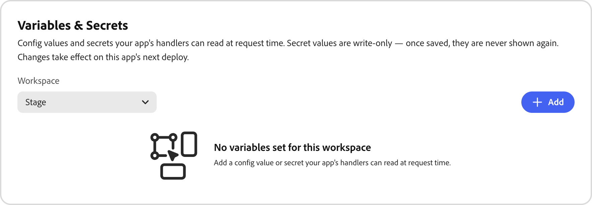
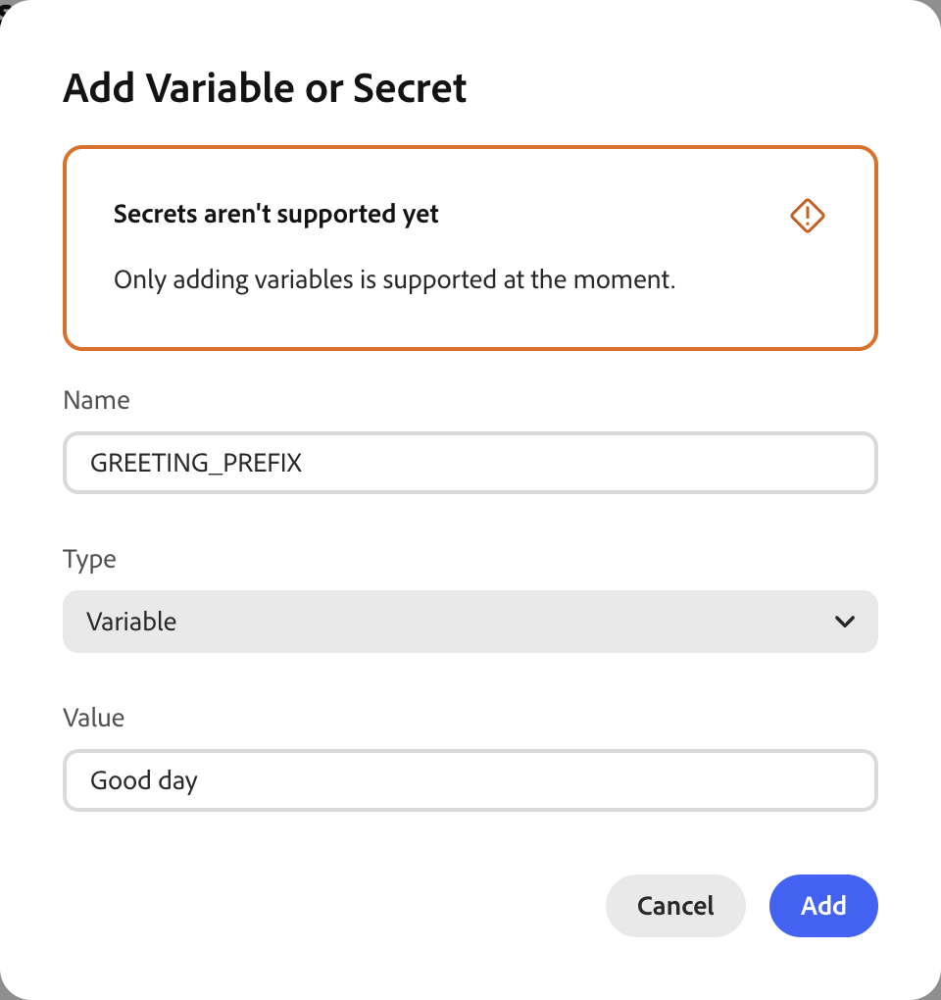
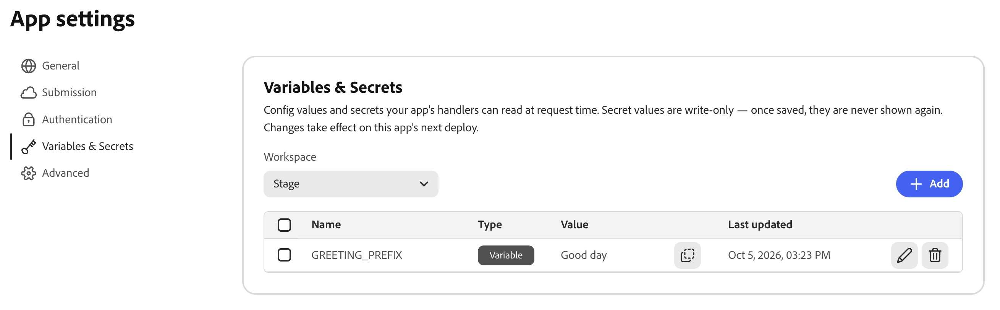
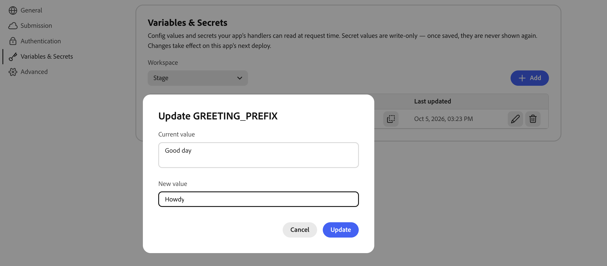
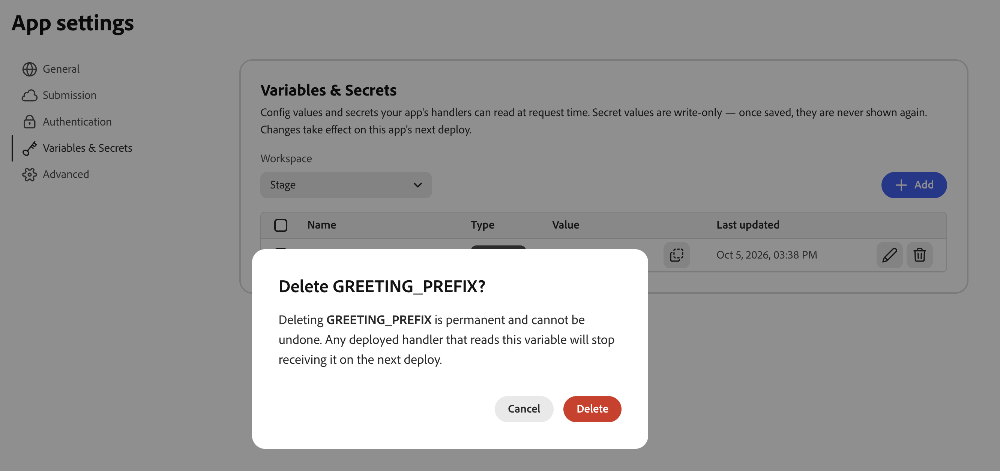

# Configuration des variables et secrets d’application {#app-variables}

>[!IMPORTANT]
>
>Les applications LLM sont disponibles pour tous les clients AEM Sites Cloud Service afin qu’ils puissent développer et gérer leurs propres applications. Une fois le comptage commencé, chaque appel d’application est comptabilisé dans les demandes de contenu AEM Sites du client. Adobe annoncera le taux de contrôle et la date de début avant que le contrôle ne prenne effet.

Utilisez des variables et des secrets pour configurer votre application sans valeurs de codage en dur dans ses gestionnaires d’actions. Par exemple, configurez l’URL de l’API du catalogue de produits pour utiliser un service de test dans l’environnement intermédiaire et le service actif dans l’environnement de production sans modifier le code du gestionnaire.

Les variables contiennent des paramètres non sensibles. Les secrets sont destinés à des valeurs sensibles telles que les clés API et les jetons d’accès.

>[!IMPORTANT]
>
>L’interface utilisateur ne prend actuellement en charge **que les variables**. La prise en charge secrète est prévue pour une version ultérieure. D’ici là, **NE stockez PAS** les mots de passe, les clés API, les jetons d’accès ou d’autres informations sensibles **dans les variables** : le tableau des paramètres affiche les valeurs de variable et permet aux utilisateurs de les copier.

**Dans ce guide :** Découvrez comment ajouter une variable d&#39;application et la lire dans un gestionnaire d&#39;actions. Déployez l’application et vérifiez que le gestionnaire utilise la valeur attendue.

## Avant de commencer {#before-you-begin}

Vous avez besoin des éléments suivants :

- **Accédez au référentiel de gestionnaires de votre application** pour mettre à jour les gestionnaires qui doivent lire des variables.
- **`@adobe/llm-apps-runtime`version 1.1.0 ou ultérieure** dans ce référentiel. Vérifiez la version avant d’utiliser l’assistant ci-dessous.

Pour vérifier la version, exécutez la commande suivante dans votre référentiel de gestionnaire :

```bash
npm ls @adobe/llm-apps-runtime
```

Si la version est antérieure à la version 1.1.0, mettez-la à niveau, puis validez et envoyez les notifications push `package.json` et `package-lock.json` :

```bash
npm install @adobe/llm-apps-runtime@latest
```

## Gestion des variables {#manage-variables}

Chaque environnement, **[!UICONTROL Évaluation]** ou **[!UICONTROL Production]**, possède ses propres variables. Vérifiez **[!UICONTROL Workspace]** avant d’ajouter, de mettre à jour ou de supprimer une variable. Les modifications prennent effet la prochaine fois que vous déployez l’application dans cet environnement.

### Ajouter une variable {#add-variable-to-app}

Cet exemple utilise la variable non sensible `GREETING_PREFIX` avec la valeur `Good day` pour remplacer le message d’accueil par défaut du gestionnaire de `Hello`. L’ajout d’une variable **ne modifie pas automatiquement** une action : le gestionnaire **doit** lire la variable.

#### Étape 1 : ajouter une variable dans l’interface utilisateur {#add-a-variable}

1. Ouvrez votre application et sélectionnez **[!UICONTROL Paramètres]** dans le volet de navigation de gauche.
2. Ouvrez l’onglet **[!UICONTROL Variables et secrets]**.
3. Dans **[!UICONTROL Workspace]**, sélectionnez **[!UICONTROL Étape]** ou **[!UICONTROL Production]**.
4. Sélectionnez **[!UICONTROL Ajouter]**.

   

5. Dans la boîte de dialogue, saisissez :
   - **[!UICONTROL Nom]** : `GREETING_PREFIX`.
   - **[!UICONTROL Type]** : laissez **[!UICONTROL Variable]** sélectionnée.
   - **[!UICONTROL Valeur]** : `Good day`.

   

6. Pour enregistrer la variable, sélectionnez **[!UICONTROL Ajouter]**.

La variable apparaît dans le tableau avec sa date de **[!UICONTROL Nom]**, **[!UICONTROL Type]**, **[!UICONTROL Valeur]** et **[!UICONTROL Dernière mise à jour]**. Pour copier la valeur, utilisez la commande de copie adjacente.



>[!IMPORTANT]
>
>L’enregistrement ajoute la variable à la configuration de l’environnement sélectionné. L’application déployée n’est **pas** mise à jour tant que vous n’avez pas effectué un nouveau déploiement.

#### Étape 2 : lire la variable dans le gestionnaire {#use-a-variable}

Dans le référentiel du gestionnaire, ouvrez `actions/<action-name>/index.js`. Assurez-vous que le gestionnaire accepte un deuxième argument, `extra`, et lisez la variable avec `getVariable` :

```javascript
const { getVariable } = require('@adobe/llm-apps-runtime');

module.exports = async ({ name = 'there' } = {}, extra) => {
  const prefix = getVariable(extra, 'GREETING_PREFIX') || 'Hello';

  return {
    content: [{ type: 'text', text: `${prefix}, ${name}!` }]
  };
};
```

Avec la valeur `Good day`, un appel avec `name` défini sur `Ada` renvoie `Good day, Ada!` au lieu du `Hello, Ada!` par défaut. Si vous modifiez ultérieurement la valeur sur `Howdy`, le message d&#39;accueil change après le redéploiement, sans autre modification de gestionnaire.

Le nom dans votre code **doit** correspondre exactement au nom dans l&#39;interface utilisateur. Si la variable n’est pas définie, `getVariable` renvoie `undefined`. Choisissez une valeur par défaut appropriée, comme dans l’exemple, ou renvoyez une erreur claire si l’action nécessite le paramètre .

>[!NOTE]
>
>Les variables ne sont disponibles que dans les gestionnaires d’actions de votre application. Elles ne sont **pas** automatiquement disponibles pour les widgets.

Lorsque les modifications apportées au gestionnaire sont prêtes, validez-les et envoyez-les au référentiel du gestionnaire de votre application. Le déploiement suivant utilise le code push le plus récent. Pour en savoir plus sur la modification des gestionnaires, voir [Personnaliser un gestionnaire généré](/help/guides/customize-handler.md).

#### Étape 3 : déployer et tester {#deploy-and-verify}

1. [Déployez votre application](/help/guides/deploy-your-app.md) dans l&#39;environnement sélectionné dans **[!UICONTROL Workspace]**.
2. Appelez l’action depuis une plateforme LLM prise en charge avec `name` défini sur `Ada`. Voir [Test du plug-in ChatGPT](/help/guides/test-in-chatgpt.md) ou [Test du connecteur Claude](/help/guides/test-in-claude.md).
3. Confirmez que la réponse est `Good day, Ada!`. La réponse vérifie que le gestionnaire lit votre variable configurée et remplace son message d’accueil par défaut.

Pour configurer l’autre environnement, sélectionnez-le dans **[!UICONTROL Workspace]**, répétez l’installation avec la valeur appropriée, puis déployez et testez l’application à cet endroit.

>[!NOTE]
>
>Les environnements intermédiaire et de production ont **des configurations indépendantes**. Les modifications apportées dans un environnement **n’affectent pas l’autre**. Utilisez le même nom dans les deux environnements si nécessaire, puis choisissez la valeur appropriée pour chacun.

>[!TIP]
>
>Pour effectuer des tests localement avant le déploiement, consultez [Développement et test de gestionnaires locaux](/help/reference/development.md) et transmettez les variables au serveur local :
>
>`node server/local.js --param 'LLMA_VARIABLE_NAMES=["GREETING_PREFIX"]' --param GREETING_PREFIX=Howdy`

### Mettre à jour une variable {#update-or-delete}

1. Sélectionnez le contrôle d’édition sur la ligne de la variable.
2. Vérifiez la **[!UICONTROL valeur actuelle]** de la variable et saisissez une **[!UICONTROL nouvelle valeur]**.

   

3. Sélectionner **[!UICONTROL Mettre à jour]**.
4. Déployez à nouveau l’application dans le même environnement et vérifiez le comportement modifié.

La mise à jour d’une variable ne modifie que sa valeur. Vous **ne pouvez pas** renommer les variables. Pour utiliser un autre nom, supprimez la variable existante, ajoutez une nouvelle variable et mettez à jour votre gestionnaire pour lire le nouveau nom.

### Supprimer une variable {#delete-a-variable}

1. Vérifiez si une action nécessite toujours la variable . Si nécessaire, mettez à jour et poussez le gestionnaire **first**.
2. Sélectionnez le contrôle de suppression sur la ligne de la variable. Pour supprimer plusieurs entrées, cochez leurs cases et choisissez **[!UICONTROL Supprimer]**.
3. Vérifiez les noms dans la boîte de dialogue de confirmation, puis sélectionnez **[!UICONTROL Supprimer]**.

   

4. Déployez à nouveau l’application dans le même environnement.

>[!IMPORTANT]
>
>Vous **NE POUVEZ PAS** annuler la suppression. Vérifiez que vous avez sélectionné la bonne variable. L’application déployée conserve sa configuration existante jusqu’au prochain déploiement. Après ce déploiement, les gestionnaires **ne reçoivent plus** la variable supprimée. Par conséquent, une action qui nécessite la variable peut échouer.

## Règles et limites {#good-to-know}

| Élément | Règle |
|------|------|
| Nom | Jusqu’à 64 caractères : lettres majuscules, chiffres et traits de soulignement, ne commençant pas par un chiffre. **Doit** être unique par application et environnement et doit correspondre au gestionnaire. |
| Noms réservés | Noms commençant par `LLMA_` et `MCP_SERVER_URL`. |
| Valeur | **Obligatoire**, jusqu&#39;à 500 caractères. La plateforme supprime les espaces de début et de fin. |
| Limite | 50 variables par application et environnement. |
| Visibilité | Les valeurs des variables sont visibles et copiables. La prise en charge des secrets planifiés conserve les valeurs enregistrées masquées. |
| Modifications | Prendre effet lors du prochain déploiement dans l’environnement sélectionné. |

## Résolution des problèmes {#verify-configuration}

| Ce que vous voyez | Que faire |
|--------------|------------|
| **[!UICONTROL Ajouter]** est désactivé et la page affiche **[!UICONTROL limite de Workspace atteinte]** | Supprimez les variables dont vous n’avez plus besoin. |
| *Utilisez uniquement des lettres majuscules, des chiffres et des traits de soulignement* | Renommez, par exemple `API_BASE_URL`. |
| *Ce nom est réservé par la plateforme* | Choisissez un nom qui ne commence pas par `LLMA_` et n&#39;est pas `MCP_SERVER_URL`. |
| *Une variable portant ce nom existe déjà* | Mettez à jour la variable existante à la place. |
| *Cette variable a été modifiée ailleurs* | Actualisez la page et réessayez. |
| *Impossible de charger les variables* | Rechargez la page. Si l’erreur persiste, vérifiez que vous avez accès à l’application. |
| L’action n’utilise pas la nouvelle valeur | Vérifiez que vous avez déployé **après** avoir enregistré la variable et testé le même environnement. Vérifiez que vous avez effectué la modification du gestionnaire et que le nom de variable correspond exactement à **1**. **[!UICONTROL La dernière mise à jour]** s’affiche lorsque vous avez enregistré la valeur, et non lorsque vous avez déployé l’application. |
| `getVariable is not a function` | Votre application utilise une exécution antérieure à 1.1.0. Mettez-le à niveau comme décrit dans [Avant de commencer](#before-you-begin), puis déployez-le. |
| L’action échoue après la suppression d’une variable | Ajoutez à nouveau la variable ou mettez à jour le gestionnaire afin qu’il n’en ait plus besoin, puis déployez. |

## Prochaines étapes {#whats-next}

- [Personnaliser un gestionnaire généré](/help/guides/customize-handler.md)
- [Déploiement de l’application](/help/guides/deploy-your-app.md)
