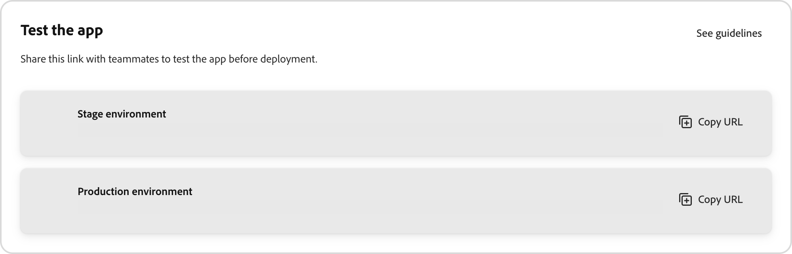
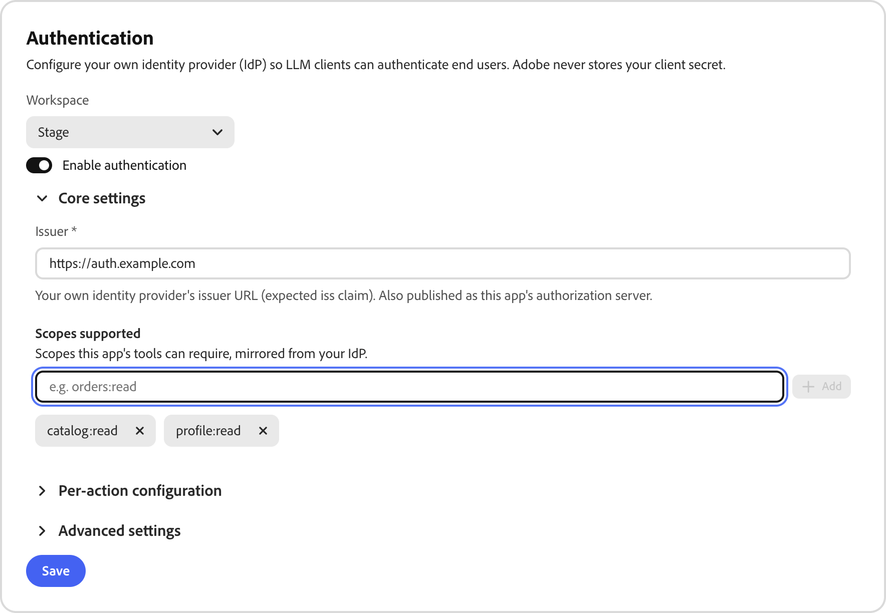
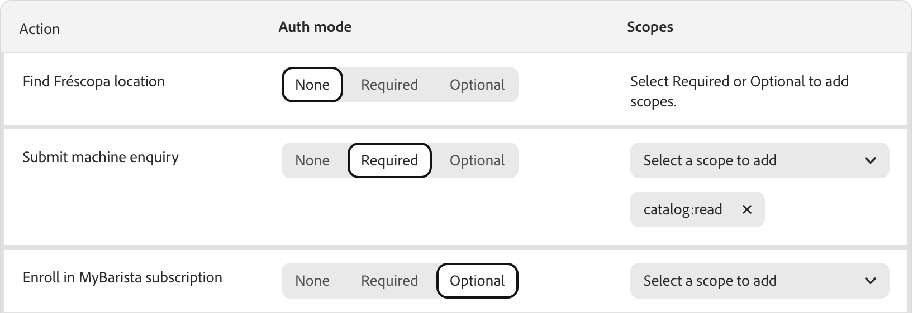

# Authentifier les utilisateurs finaux avec votre propre fournisseur d’identité {#authentication}

>[!IMPORTANT]
>
>Les applications LLM sont disponibles pour tous les clients AEM Sites Cloud Service afin qu’ils puissent développer et gérer leurs propres applications. Une fois le comptage commencé, chaque appel d’application est comptabilisé dans les demandes de contenu AEM Sites du client. Adobe annoncera le taux de contrôle et la date de début avant que le contrôle ne prenne effet.

Par défaut, chaque action de votre application est publique. Toute plateforme LLM avec votre URL de serveur MCP peut appeler ces actions et votre gestionnaire ne peut pas identifier l’utilisateur final.

Activez l’authentification lorsqu’une action doit savoir quel utilisateur final demande, par exemple, de renvoyer ses commandes, ses droits ou les détails de son compte. La plateforme LLM connecte l’utilisateur avec **votre** fournisseur d’identité (IdP), envoie le jeton d’accès résultant avec chaque appel et votre gestionnaire reçoit l’identité vérifiée.

**Dans ce guide :** Découvrez comment connecter votre fournisseur d&#39;identité et choisir les actions qui nécessitent une connexion. Utilisez l’identité vérifiée dans vos gestionnaires, déployez l’application et testez la connexion et les actions protégées.

La configuration de l&#39;authentification est une tâche avancée. Terminez la [configuration de l’infrastructure](/help/guides/create-app.md), [Créez des actions](/help/guides/creating-actions.md) et [Déployez d’abord votre application](/help/guides/deploy-your-app.md).

## Fonctionnement

Vous apportez votre propre fournisseur d’identité. L’application déployée n’est qu’un **serveur de ressources** OAuth 2.1 : elle vérifie les jetons émis par votre serveur d’autorisation. Il n&#39;émet jamais de jetons et [!DNL Adobe] ne stocke jamais votre identifiant client ou secret client.

```
┌── Your identity provider ───────────────────────────────────────────────┐
│  Authorization server — you own it                                      │
│  Issues access tokens, holds the user directory, defines the scopes     │
└─────────────────────────────────────────────────────────────────────────┘
        ▲  2  user signs in, platform gets an access token
        │                                    │
        │  1  platform discovers your        │  3  every tools/call carries
        │     authorization server from      │     Authorization: Bearer <token>
        │     your app's metadata            ▼
┌── LLM platform (ChatGPT, Claude, …) ────────────────────────────────────┐
└─────────────────────────────────────────────────────────────────────────┘
                                             │
                                             ▼
┌── Your LLM App on Adobe I/O Runtime ────────────────────────────────────┐
│  Resource server — verifies the token's signature, issuer, audience,    │
│  and expiry, then enforces the auth mode you set for each action        │
│                                                                         │
│  Your handler reads the verified identity from its second argument      │
└─────────────────────────────────────────────────────────────────────────┘
```

Configurez l’authentification **par environnement**. **[!UICONTROL L’étape]** et **[!UICONTROL la production]** contiennent des paramètres indépendants. Vérifiez la configuration par rapport à un client IdP de développement avant d’activer l’authentification sur **[!UICONTROL Production]**.

## Avant de commencer

- Un fournisseur d’identité OAuth 2.1 ou OpenID Connect qui émet **des jetons d’accès JWT** signés avec un algorithme asymétrique. Les jetons opaques et les jetons signés HMAC ne sont pas pris en charge. Consultez [Exigences en matière de jeton](/help/reference/authentication-reference.md#token-requirements).
- Un accès administrateur à ce fournisseur d’identité pour enregistrer une API et un client.
- Votre application a été déployée au moins une fois dans l’environnement que vous êtes en train de configurer. L’URL du serveur MCP déployé est la valeur sur laquelle vos jetons doivent être inclus.

## Copier l’identifiant de la ressource

L’**identifiant de ressource** de votre application est son URL de serveur MCP. Chaque jeton d’accès émis par votre fournisseur d’identité pour l’application doit nommer cette URL exacte comme audience. Cette liaison d’audience empêche l’utilisation d’un jeton émis pour un autre service.

1. Ouvrez la page Détails de l’application .
2. Faites défiler jusqu’à **[!UICONTROL Tester l’application]**.
3. Sous l’environnement que vous configurez, sélectionnez **[!UICONTROL Copier l’URL]**.



Conservez l’URL du serveur MCP copiée pour la configuration du fournisseur d’identité à l’étape suivante. Collez l’URL plutôt que de la saisir à nouveau. La vérification de l’audience nécessite une correspondance de chaîne exacte, y compris le chemin d’accès. Une seule différence de caractère entraîne l’échec de la validation de chaque jeton.

>[!NOTE]
>
>Chaque environnement possède sa propre URL de serveur MCP, et donc sa propre audience. Configurez **[!UICONTROL l’étape]** et **[!UICONTROL la production]** séparément.

## Configuration de votre fournisseur d’identité

Les étapes varient selon le fournisseur. Configurez les quatre éléments suivants.

1. **Enregistrez votre application en tant qu&#39;API (ressource).** Définissez son identifiant (la valeur que le fournisseur place dans la réclamation `aud` du jeton) sur l’URL du serveur MCP copiée. Les fournisseurs étiquettent généralement ce champ *Identifiant* ou *Audience*. Utilisez un identifiant unique à l’application, et non une valeur générique telle que `api`, pour empêcher l’utilisation de jetons émis pour un autre service.
2. **Définissez les portées** qui protègent vos actions, par exemple `orders:read` ou `profile:read`. Utilisez une portée par autorisation significative afin que chaque action ne demande que l’accès dont elle a besoin.
3. **Prise en charge PKCE.** Les plateformes LLM envoient un `code_challenge` avec `code_challenge_method=S256` sur chaque demande d’autorisation. Votre serveur d’autorisation doit donc prendre en charge S256 PKCE et faire de la publicité pour `"code_challenge_methods_supported": ["S256"]` dans ses métadonnées.
4. **Choisissez comment la plateforme LLM identifie son client OAuth.** Utilisez les documents CIMD (Client ID Metadata Documents) si votre fournisseur prend en charge les exigences de la plateforme, l’enregistrement client dynamique (DCR) ou un client OAuth préenregistré. Fournissez un identifiant client et un secret uniquement lorsque la méthode choisie les requiert. Enregistrez l’URI de redirection exact documenté ou affiché par la plateforme ; pour les surfaces hébergées de [!DNL Claude] qui est `https://claude.ai/api/mcp/auth_callback`. [!DNL ChatGPT] peut utiliser un rappel stable ou spécifique au connecteur en fonction des fonctionnalités annoncées du fournisseur. Par conséquent, copiez son URI affiché plutôt que de faire des suppositions. Consultez la [documentation actuelle sur l&#39;authentification ChatGPT](https://developers.openai.com/plugins/build/auth) et [la documentation sur l&#39;authentification Claude](https://claude.com/docs/connectors/building/authentication).

>[!IMPORTANT]
>
>Les points d’entrée d’émetteur, JWKS, d’autorisation et de jeton de votre fournisseur d’identité doivent tous être accessibles via HTTPS public. La plateforme LLM et votre application déployée récupèrent des métadonnées directement auprès de votre fournisseur. Un VPN, une liste autorisée IP, un pare-feu ou un pare-feu d’application web qui bloque ces requêtes empêche la connexion, même si l’application elle-même reste accessible.

## Activer l’authentification

1. Dans le volet de navigation de gauche, sélectionnez **[!UICONTROL Paramètres]**, puis ouvrez l’onglet **[!UICONTROL Authentification]**.
2. Dans **[!UICONTROL Workspace]**, choisissez **[!UICONTROL Étape]** ou **[!UICONTROL Production]**.
3. Activer **[!UICONTROL Activer l&#39;authentification]**.
4. Sous **[!UICONTROL Paramètres principaux]**, saisissez :
   - **[!UICONTROL Émetteur]** : URL de l’émetteur HTTPS de votre fournisseur d’identité, qui est également la valeur qu’il place dans la réclamation `iss` de chaque jeton. La plateforme nécessite cette URL et publie l’émetteur en tant que serveur d’autorisation de l’application pour la découverte de clients LLM. Chaque application prend en charge un fournisseur d’identité.
   - **[!UICONTROL Portées prises en charge]** — chaque portée que les actions de cette application sont autorisées à exiger. Reflète les portées que vous avez définies dans votre fournisseur d’identité.
5. **[!UICONTROL Les paramètres avancés]** sont facultatifs. Définissez l’**[!UICONTROL URI JWKS]** uniquement lorsque vos clés de signature ne se trouvent pas à l’endroit où les métadonnées de votre serveur d’autorisation les annoncent ; dans le cas contraire, l’application les découvre automatiquement.
6. Sélectionnez **[!UICONTROL Enregistrer]**.



Pour connaître la configuration requise, voir [Paramètres d&#39;authentification](/help/reference/authentication-reference.md#authentication-settings).

## Choisir un mode d’authentification pour chaque action

Lorsque vous activez **[!UICONTROL Activer l’authentification]**, chaque action actuellement définie sur **[!UICONTROL Aucune]** est remplacée par **[!UICONTROL Obligatoire]**. Sous **[!UICONTROL Configuration par action]**, vérifiez cette affectation et définissez le mode dont chaque action a besoin :

| Mode | Comportement |
|------|----------|
| **[!UICONTROL Aucune]** | Publique. Les appelants n’ont pas besoin de jeton. |
| **[!UICONTROL Requis]** | Protégé. Les appelants ont besoin d’un jeton valide qui transfère chaque portée répertoriée. Le runtime demande aux appelants non authentifiés de se connecter. |
| **[!UICONTROL Facultatif]** | Appelable anonymement, mais l’action indique également qu’elle prend en charge la connexion. Votre gestionnaire décide par appel de signifier ou non un résultat générique ou de demander à l’utilisateur de se connecter pour un résultat personnalisé. |



Les actions déjà définies sur **[!UICONTROL Obligatoires]** ou **[!UICONTROL Facultatives]** conservent leur mode existant.

Pour une action **[!UICONTROL requise]** ou **[!UICONTROL facultative]**, ajoutez les **[!UICONTROL portées]** dont elle a besoin. Chaque portée doit déjà apparaître dans **[!UICONTROL Portées prises en charge]** afin que l&#39;application annonce chaque autorisation requise sur les plateformes LLM. La plateforme bloque l’enregistrement jusqu’à ce que vous résolviez toute incohérence d’étendue.

**[!UICONTROL Étendues prises en charge]** contrôle les étendues disponibles. La suppression d’une portée de cette liste supprime immédiatement la portée de chaque action qui l’exigeait. Ajoutez chaque étendue à la liste avant d’affecter l’étendue à une action.

La sélection de **[!UICONTROL Exiger une authentification pour toutes les actions]** modifie **[!UICONTROL Aucune]** action en **[!UICONTROL Obligatoire]**, mais conserve les actions déjà définies en **[!UICONTROL Facultatif]**. Pour exiger la connexion pour chaque action, modifiez les **[!UICONTROL lignes facultatives]** restantes en **[!UICONTROL Obligatoires]** individuellement. Décocher la case renvoie chaque action à **[!UICONTROL Aucune]**.

Sélectionnez **[!UICONTROL Enregistrer]** lorsque vous avez terminé. Les modifications du mode d’authentification et de l’étendue sont enregistrées avec les paramètres au niveau de l’application.

>[!IMPORTANT]
>
>La désactivation de l’**[!UICONTROL authentification]** efface le mode d’authentification et les portées de chaque action pour l’environnement sélectionné. La plateforme ne conserve pas ces paramètres. L&#39;activation de l&#39;authentification définit à nouveau toutes les actions sur **[!UICONTROL Obligatoire]**.

>[!NOTE]
>
>Définir chaque action sur **[!UICONTROL Aucune]** ne désactive pas l&#39;authentification. Aucune action ne nécessite une connexion dans cet état, mais l’application publie toujours votre serveur d’autorisation sur les plateformes LLM. Un client peut proposer une connexion qui n’accorde aucun accès supplémentaire. Pour rendre l’application entièrement publique, désactivez **[!UICONTROL Activer l’authentification]** et déployez.

[!DNL ChatGPT] prend en charge les modes d&#39;authentification mixtes dans une application et applique individuellement le mode de chaque action. Les actions publiques ne demandent pas de connexion ; les actions protégées le demandent si nécessaire.

[!DNL Claude] prend également en charge les applications mixtes via l’**authentification différée**. Avec l’option **[!UICONTROL Se connecter si nécessaire]** sélectionnée lors de la configuration du connecteur, les actions publiques restent utilisables anonymement et la plateforme demande à se connecter lorsqu’une action **[!UICONTROL Requise]** est appelée. Une application dont les actions sont toutes **[!UICONTROL Requises]** nécessite une connexion avant utilisation. Voir [Comportement de plateforme LLM](/help/reference/authentication-reference.md#platform-behavior) pour la distinction entre une action requise et un gestionnaire facultatif demandant la connexion.

>[!NOTE]
>
>L’exécution actuelle prend en charge ce comportement d’authentification mixte, vérifié par rapport à la version 1.1.5. Les applications déployées plus anciennes peuvent nécessiter une mise à jour et un redéploiement de l’exécution. Certaines versions de l’interface utilisateur affichent toujours un avertissement hérité selon lequel Claude requiert une authentification pour l’ensemble du connecteur. Vérifiez le runtime déployé et utilisez l&#39;option actuelle de Claude **[!UICONTROL Connexion en cas de besoin]** au lieu de compter sur l&#39;avertissement.

## Déployer la modification

Les modifications d’authentification prennent effet lors du prochain déploiement de cette application. **Déployez à nouveau l’application** dans l’environnement que vous avez configuré. Voir [Déployer votre application](/help/guides/deploy-your-app.md).

L’URL de votre serveur MCP ne change pas. Actualisez les métadonnées de la connexion et vérifiez que ses paramètres d’authentification correspondent à la nouvelle configuration de l’application. Une plateforme peut nécessiter que vous reconnectiez ou recréiez la connexion lorsque sa méthode d’authentification change.

## Lire l’identité dans votre gestionnaire

Une identité vérifiée atteint votre gestionnaire en tant que deuxième argument chaque fois que l’appelant envoie un jeton valide, quel que soit le mode d’authentification de l’action. Une action **[!UICONTROL Facultative]** peut utiliser cette identité pour personnaliser les résultats lorsqu’ils sont disponibles et renvoyer un résultat anonyme dans le cas contraire.

Utiliser `getAuthenticatedUser` pour lire l&#39;utilisateur connecté :

```javascript
const { getAuthenticatedUser } = require('@adobe/llm-apps-runtime');

module.exports = async ({ orderId }, extra) => {
  const userId = getAuthenticatedUser(extra);

  if (!userId) {
    return { content: [{ type: 'text', text: 'Sign in to see your orders.' }] };
  }

  const order = await fetchOrderForUser(userId, orderId);

  return {
    content: [{ type: 'text', text: `Order ${order.id} is ${order.status}.` }],
    structuredContent: order
  };
};
```

L’exécution vérifie le jeton à votre place. Pour une action **[!UICONTROL Required]**, il bloque chaque appel ne disposant pas de jeton valide avec les portées répertoriées. Le gestionnaire s’exécute uniquement pour un appelant autorisé. Utilisez `hasScope` pour choisir le comportement du gestionnaire en fonction d’une autorisation, par exemple, dans une action **[!UICONTROL Facultative]**.

Pour demander la connexion lors d’une conversation, renvoyez `extra.challengeAuth()` à partir du gestionnaire. L&#39;helper est disponible uniquement sur les actions **[!UICONTROL facultatives]** :

```javascript
module.exports = async ({ signIn }, extra) => {
  if (signIn && !extra.authInfo) {
    return extra.challengeAuth({
      error: 'invalid_token',
      errorDescription: 'Sign in to see member pricing.'
    });
  }

  return {
    content: [{
      type: 'text',
      text: extra.authInfo ? await memberDeals() : await publicDeals()
    }]
  };
};
```

Utilisez un paramètre d’entrée explicite, tel que `signIn` dans cet exemple, pour décider quand demander une authentification. Ne déduisez pas cette décision du libellé de l’utilisateur.

Définissez `error` pour qu&#39;il corresponde à la condition signalée. Utilisez `invalid_token` lorsque l&#39;appelant n&#39;a aucune session valide et doit se connecter, comme dans l&#39;exemple ci-dessus. Utilisez `insufficient_scope` lorsque l’appelant est connecté mais que le jeton n’a pas une portée requise. Chaque plateforme LLM choisit le libellé de l’invite et la manière de répondre au code d’erreur. Envoyez le code qui décrit précisément la condition.

Demander une authentification uniquement lorsque l&#39;identité requise est manquante, comme le fait la vérification `!extra.authInfo` dans cet exemple. La connexion ne résout pas un problème inconditionnel : le gestionnaire demande à nouveau une authentification à chaque appel.

>[!NOTE]
>
>`extra.challengeAuth()` renvoie un défi de résultat d’outil pour [!DNL ChatGPT]. [!DNL Claude] a plutôt besoin d’un défi d’authentification HTTP avant l’exécution du gestionnaire. Pour une opération qui nécessite une connexion sur les plateformes prises en charge, utilisez une action **[!UICONTROL Requis]**. Conserver une action **[!UICONTROL Aucune]** distincte pour l’expérience publique, si nécessaire.

Conserver l’identité côté serveur. Transmettez uniquement les données nécessaires au widget dans `structuredContent`. Ne jamais inclure de jeton d&#39;accès dans `structuredContent`. Voir [Personnaliser un gestionnaire généré](/help/guides/customize-handler.md).

Pour le contrat complet, voir [API d&#39;authentification de gestionnaire](/help/reference/authentication-reference.md#handler-auth-api).

## Tester l’application protégée

Votre plug-in ou connecteur existant utilise la configuration mise à jour après le déploiement. Pour créer une connexion, suivez les instructions correspondant à votre plateforme :

### [!DNL ChatGPT]

Dans la boîte de dialogue **[!UICONTROL Nouveau plug-in]**, définissez **[!UICONTROL Authentification]** pour correspondre à la manière dont vous avez configuré les actions de l’application :

| Actions de votre application | Sélectionner |
|--------------------|--------|
| Tout est défini sur **[!UICONTROL Aucun]** | **[!UICONTROL Aucune Authentification]** |
| Tout est défini sur **[!UICONTROL Obligatoire]** | **[!UICONTROL Oauth]** |
| Toute autre combinaison | **[!UICONTROL Mixte]** |

Une action **[!UICONTROL facultative]** accepte toujours les appels anonymes, de sorte qu&#39;une application qui en contient un n&#39;est jamais complètement fermée ; choisissez **[!UICONTROL Mixte]** même si chaque action est définie sur **[!UICONTROL Facultative]**. Seul **[!UICONTROL Obligatoire]** refuse les appelants non authentifiés.

Voir [Tester le plug-in ChatGPT](/help/guides/test-in-chatgpt.md) pour la suite de la boîte de dialogue.

### [!DNL Claude]

Ajoutez le connecteur personnalisé et vérifiez ses paramètres d’authentification. Pour une application mixte publique/protégée, choisissez **[!UICONTROL Se connecter si nécessaire]** lorsqu&#39;elle est disponible. Pour demander une connexion avant l’utilisation du connecteur, sélectionnez **[!UICONTROL Se connecter maintenant]**. La boîte de dialogue varie selon le compte ou l’organisation. Consultez [Tester le connecteur Claude](/help/guides/test-in-claude.md).

### Vérifier

- La plateforme vous redirige vers la page de connexion de votre propre fournisseur d’identité.
- Une action protégée renvoie des données spécifiques à l’utilisateur après la connexion.
- Une action protégée vous invite à vous connecter lorsque vous êtes déconnecté.
- Sur une application mixte, une action définie sur **[!UICONTROL Aucune]** répond toujours sans se connecter. Dans [!DNL Claude], vérifiez l’action publique avec **[!UICONTROL Se connecter si nécessaire]**.
- Après vous être connecté, réessayez l’action protégée et vérifiez que le runtime applique les autorisations attendues.

Si la connexion ne démarre pas ou si un jeton est rejeté, voir [Dépannage](/help/reference/troubleshooting.md#authentication).

## Conseils de sécurité

- Accordez la portée la plus étroite dont chaque action a besoin. Ne réutilisez pas une portée large pour chaque action.
- Conservez le secret client dans votre fournisseur d’identité et dans la configuration du connecteur de la plateforme LLM. Ne le mettez jamais en action avec des métadonnées, du code de gestionnaire, un JavaScript de widget ou un contrôle de code source.
- Traiter les revendications de jeton comme une entrée provenant d’un système externe. Validez les valeurs de `authInfo.extra` avant d&#39;utiliser ces valeurs dans une requête.
- Autoriser et authentifier. Un jeton valide prouve l’identité de l’utilisateur, et non l’autorisation de lire un enregistrement particulier. Vérifiez la propriété dans votre gestionnaire avant de renvoyer les données.
- Ne consignez pas de jetons, de jeux de réclamations complets ou d’identifiants d’utilisateur.
- Renvoyer les erreurs sécurisées. Ne faites pas apparaître les réponses du fournisseur d’identité en amont ni les traces de pile à l’utilisateur.
- Configurez et vérifiez l’**[!UICONTROL étape]** par rapport à un client de fournisseur d’identité hors production avant d’activer l’authentification sur **[!UICONTROL production]**.

## Prochaines étapes

- [Référence d’authentification](/help/reference/authentication-reference.md) : champs, exigences de jeton et comportement de la plateforme.
- [Personnaliser un gestionnaire généré](/help/guides/customize-handler.md) — appeler une API en amont protégée depuis un gestionnaire.
- [Déployez votre application](/help/guides/deploy-your-app.md).
