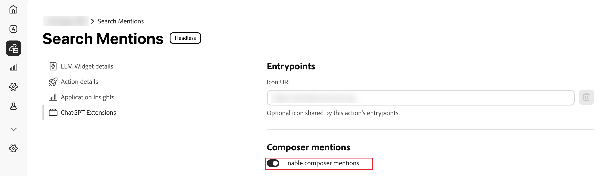

# Configurer les extensions de ChatGPT {#chatgpt-extensions}

>[!IMPORTANT]
>
>Les applications LLM sont disponibles pour tous les clients AEM Sites Cloud Service afin qu’ils puissent développer et gérer leurs propres applications. Une fois le comptage commencé, chaque appel d’application est comptabilisé dans les demandes de contenu AEM Sites du client. Adobe annoncera le taux de contrôle et la date de début avant que le contrôle ne prenne effet.

**Il s’agit d’extensions ChatGPT uniquement.** Ils ne configurent pas de fonctionnalités dans [!DNL Claude] ou d&#39;autres plateformes LLM. Votre application peut toujours fonctionner sur ces plateformes par le biais de ses actions et widgets standard.

Utilisez les **[!UICONTROL extensions ChatGPT]** pour permettre aux utilisateurs d&#39;ouvrir directement votre application, de la conserver à côté d&#39;une conversation, d&#39;afficher les fichiers pris en charge ou de rechercher des éléments lors de la composition d&#39;un message.

**Dans ce guide :** Découvrez comment configurer ces fonctionnalités facultatives et ce que les utilisateurs peuvent en faire. Un catalogue de produits en est un exemple ; activez uniquement les fonctionnalités dont votre application a besoin.

Les contours rouges des captures d’écran mettent en surbrillance les commandes utilisées dans les étapes. Il s’agit d’annotations de documentation, et non d’indicateurs d’erreur de l’interface utilisateur.

## Avant de commencer {#before-you-begin}

Vous avez besoin des éléments suivants :

- Une application LLM existante, l’autorisation de modifier ses actions et une action de travail pour la tâche.
- Widget publié pour l’ouverture directe ou l’affichage de fichiers. Les actions de texte uniquement peuvent fournir une recherche de mention, mais pas de points d’entrée.
- `@adobe/llm-apps-runtime` 1.3.0 et, pour les fonctionnalités de widget, `@adobe/llmapps-sdk` 0.2.1, ou des versions ultérieures prises en charge. Demandez au responsable de l’application de confirmer les deux versions et de mettre à jour les scripts de widget diffusés si nécessaire.
- Une application connectée et un client qui prend en charge l’extension sélectionnée.

>[!IMPORTANT]
>
>La disponibilité varie selon le client. Les points d&#39;entrée de fichier sont **pour bureau uniquement** ; les mentions du compositeur nécessitent **le bureau ou le navigateur de travail**. La colonne de prise en charge web d’OpenAI exclut le [!DNL ChatGPT] classique. Vérifiez la [prise en charge de la plateforme](https://github.com/openai/mcp-extensions/blob/main/docs/spec.md#platform-support) avant de procéder au test.

>[!IMPORTANT]
>
>Les paramètres **ne créent pas** de visionneuse de fichiers ou n’implémentent pas la recherche. Demandez à votre responsable de préparer d’abord l’[action](/help/guides/customize-handler.md) et le [widget](/help/guides/widgets.md) requis.

## Ouvrir les extensions GPT de conversation {#open-extensions}

1. Ouvrez votre application et sélectionnez **[!UICONTROL Actions]**.
1. Ouvrez l’action à configurer.
1. Sélectionnez l’onglet **[!UICONTROL Extensions ChatGPT]**.

L’onglet est également disponible lors de la création de l’action. Ce guide utilise une action existante et révisée.

Sélectionnez **[!UICONTROL Enregistrer les modifications]** après modification. Pour publier la configuration, suivez [Déployer votre application](/help/guides/deploy-your-app.md) et [actualiser la connexion ChatGPT](/help/guides/test-in-chatgpt.md#refresh-after-app-changes).

## Choisir l’emplacement d’ouverture de votre application {#configure-entrypoints}

Un **point d’entrée** est un endroit où les utilisateurs ouvrent votre application sans demander au modèle de l’appeler.

>[!NOTE]
>
>Vous pouvez sélectionner plusieurs points d’entrée pour le même widget. Les points d’entrée offrent des moyens supplémentaires de l’ouvrir ; ils ne remplacent pas les appels de conversation normaux. Lorsque l’action est disponible pour le modèle, les personnes peuvent toujours la demander dans le chat et recevoir son widget.

1. Sous **[!UICONTROL Points d’entrée]**, vous pouvez éventuellement saisir une URL d’image HTTPS publique dans **[!UICONTROL URL de l’icône]**. L’icône est partagée par les points d’entrée de cette action. Utilisez une image que vous êtes autorisé à publier.
1. Sous **[!UICONTROL Où les utilisateurs peuvent ouvrir cette application]**, cochez n&#39;importe quelle combinaison des cases suivantes pour le même widget. Ne cochez pas toutes les cases si l’action ne nécessite pas d’ouverture directe.

   | Type&nbsp; | Résultat |
   |---|---|
   | **[!UICONTROL Global]** | Ouvrir le catalogue en mode plein écran à partir de la navigation |
   | **[!UICONTROL Thread]** | Ouvrez le catalogue sous la forme d’un onglet en regard d’une conversation |
   | **[!UICONTROL Fichier]** | Ouvrez les fichiers correspondants dans votre visionneuse personnalisée |

1. Pour Global ou Thread, vérifiez que l’action fonctionne sans les entrées requises.
1. Pour le fichier , effectuez la configuration ci-dessous.

Par exemple, sélectionnez à la fois Global et Thread pour ouvrir le même widget de catalogue à partir de la navigation ou à côté d’une conversation. Vous pouvez également sélectionner Fichier si le widget prend en charge l’affichage des fichiers. Lorsque Fichier est combiné avec Global ou Thread, ne cochez pas **[!UICONTROL Obligatoire]** pour l’entrée `file` : les lancements de fichiers fournissent toujours l’objet de fichier, mais les lancements globaux et de threads n’ont pas d’entrée. Le gestionnaire et le widget doivent prendre en charge les deux cas. Une action Fichier uniquement peut nécessiter `file`.

**Résultat attendu :** ouvrez le catalogue à partir de la navigation pour Global ou sous la forme d’un onglet côté conversation pour Thread.

### Ouvrir à partir de la navigation ou d’une conversation {#test-global-thread}

Les captures d’écran fournies par l’utilisateur ci-dessous illustrent le tableau de bord **Accueil** plutôt que l’exemple de catalogue. La navigation et l’emplacement des menus peuvent varier en fonction du client.

Pour **Global**, ouvrez le menu de navigation et sélectionnez le point d’entrée de votre application. Dans cet exemple, le point d’entrée est **Accueil**.

Vérifiez que le tableau de bord s’ouvre en plein écran, avec le rail de navigation toujours disponible.

Pour le **thread**, ouvrez le menu de conversation, sélectionnez **[!UICONTROL Plug-ins]** et choisissez le point d’entrée. Vérifiez que le widget s’ouvre à côté de la conversation sans avoir besoin d’une nouvelle invite.

### Ouvrez un fichier pris en charge dans votre application {#file-entrypoint}

Pour une visionneuse de catalogue CSV préparée :

1. Cochez la case **[!UICONTROL Fichier]**, sélectionnez **[!UICONTROL Ajouter une extension]** et saisissez `.csv`. Ajoutez chaque extension prise en charge dans son propre champ.
1. Sous **[!UICONTROL Détails de l’action]** > **[!UICONTROL Paramètres d’entrée]**, confirmez un paramètre **Objet** nommé `file` qui accepte `name` et `resourceUri`. La sélection de Fichier ajoute une entrée Objet facultative s&#39;il n&#39;existe aucun paramètre `file` ; vérifiez toute définition existante. Aucune autre entrée ne peut être requise. Garder `file` facultatif si Global ou Thread est également sélectionné.
1. Dans un client de bureau pris en charge, ouvrez un fichier `.csv` non sensible avec votre application.

**Résultat attendu :** Votre widget affiche le fichier. L’enregistrement des modifications nécessite en outre une prise en charge des modifications implémentée et un fichier accessible en écriture.

>[!IMPORTANT]
>
>Les points d’entrée de fichier sont différents des paramètres du fichier chargé. Ils reçoivent une référence de ressource de fichier ouvert, et non une URL de téléchargement de chargement ou un ID de fichier.

## Choisir l’affichage de l’application {#display-settings}

Sous **[!UICONTROL Mode d&#39;affichage]** :

1. Définissez **[!UICONTROL Afficher lors du lancement par le modèle]** sur `inline`, `fullscreen` ou **[!UICONTROL Aucune préférence]**.
1. Sélectionnez les **[!UICONTROL modes d’affichage des ressources pris en charge]** du widget : en ligne, plein écran, ou les deux. Ne cochez pas ces deux options pour utiliser les paramètres par défaut de l&#39;hôte.
1. Choisissez **[!UICONTROL Affichage initial des ressources]**. Si vous avez sélectionné les modes pris en charge, le mode initial doit être inclus.

Ce sont des préférences ; [!DNL ChatGPT] choisit la présentation finale. Le mode Plein écran ne crée pas d’onglet de panneau latéral : utilisez un point d’entrée Thread pour cela.

Vérifiez que le widget reste utilisable dans chaque mode que vous annoncez.

## Laisser les personnes trouver des ressources dans le compositeur {#composer-mentions}

Les mentions du compositeur permettent aux utilisateurs de rechercher et de sélectionner des éléments de catalogue lors de l’écriture d’un message. Utilisez une action qui renvoie déjà des résultats de recherche sélectionnables.

1. Ouvrez l’action de recherche et sélectionnez **[!UICONTROL Détails de l’action]**.
1. Confirmez une entrée de **chaîne** nommée `query` qui accepte du texte vide, sans autres entrées requises.
1. Dans les **[!UICONTROL paramètres LLM]**, activez **[!UICONTROL Conseils en lecture seule]** et **[!UICONTROL Afficher comme widget dans la surface de l’application]**. L’action de recherche doit être en lecture seule.
1. Dans **[!UICONTROL Extensions ChatGPT]**, activez **[!UICONTROL Activer les mentions du compositeur]**.
1. Un seul fournisseur est autorisé par application. Si vous en remplacez un, désactivez les mentions sur l&#39;ancien fournisseur et enregistrez-le avant d&#39;activer le nouveau fournisseur.

**Résultat attendu :** recherchez un produit connu dans la recherche de mention du compositeur de l’application, sélectionnez-le et confirmez que la ressource prévue est référencée dans le message.

Le paramètre de visibilité rend l’action de recherche disponible pour l’application. Le fournisseur n’a pas besoin de son propre widget visuel.

L’exemple suivant utilise **Mentions de recherche**, une action de recherche textuelle uniquement qui recherche des documents synthétiques plutôt que le catalogue. Son entrée `query` est une **chaîne** avec l’attribut **Obligatoire** décoché.

Dans l&#39;onglet **[!UICONTROL Extensions ChatGPT]** de la même action, **[!UICONTROL Activer les mentions du compositeur]** est activé.

Si une autre action fournit déjà la recherche de mention, le bouton (bascule) n’est pas disponible et un avertissement identifie cette action. Désactivez les mentions sur le fournisseur existant et enregistrez-les avant d&#39;activer un remplacement.

## Fonctionnalités supplémentaires du widget ChatGPT {#additional-widget-features}

Le SDK prend également en charge les liens profonds spécifiques au ChatGPT, le contexte de sélection étendu, les brouillons modifiables et le ciblage des conversations. Ils nécessitent une implémentation de widget, pas un autre commutateur dans cet onglet.

| Si votre widget fournit | Tester |
|---|---|
| Lien vers un élément | Ouvrez le lien et confirmez que le produit prévu s’affiche |
| Contexte de sélection | Sélectionnez un produit non sensible et posez une question à son sujet |
| Contrôle de brouillon ou de nouvelle conversation | Confirmez que le message s’ouvre comme prévu et qu’un brouillon n’est pas automatiquement envoyé |

La messagerie de widget de base et d’autres API SDK standard ne sont pas accessibles uniquement via ChatGPT. Demandez à votre responsable quelles extensions votre widget implémente ; consultez la [documentation de SDK](https://www.npmjs.com/package/@adobe/llmapps-sdk).

## Modification ou suppression d’une extension {#change-or-remove}

Dans le même onglet, décochez la case du point d&#39;entrée ou désactivez **[!UICONTROL Activer les mentions du compositeur]**. Effacez le fichier s’il ne reste aucune extension. Pour supprimer l’icône partagée, sélectionnez **[!UICONTROL Effacer l’icône]**. Pour restaurer les paramètres d&#39;affichage par défaut, sélectionnez **[!UICONTROL Aucune préférence]**, effacez les modes pris en charge, puis sélectionnez **[!UICONTROL Hôte par défaut]**.

La suppression d’un point d’entrée ne supprime pas les fichiers d’action ou d’utilisateur. Voir [règles et définitions de champ](/help/reference/reference-docs.md#chatgpt-extension-fields).

## Résolution des problèmes {#troubleshooting}

| Ce que vous voyez | Que faire |
|---|---|
| Fonctionnalité ou commandes manquantes | Vérifiez la prise en charge du client [1. &#x200B;](#before-you-begin)Pour les points d’entrée, vérifiez qu’un widget est configuré. Ces extensions ne s&#39;appliquent pas à Claude ou aux autres hôtes |
| Enregistrement des rapports avec une entrée requise incompatible | Approvisionnement global/de thread sans entrées, le fichier fournit `file` et mentionne l’approvisionnement `query`. Demandez au responsable de résoudre l’incohérence ; ne supprimez pas une entrée dont l’action a besoin |
| Échec de la configuration ou de l’affichage des fichiers | Ajoutez une extension prise en charge, confirmez l’entrée Objet `file` et utilisez un client de bureau compatible. Le widget doit implémenter ce format de fichier |
| Échec de l’enregistrement du fichier | Confirmez la prise en charge de la modification et l’autorisation d’écriture. Réconcilier les conflits au lieu de remplacer le contenu plus récent ; réduire le contenu surdimensionné |
| Impossible d’enregistrer l’URL de l’icône | Saisissez une URL d’image ou de données valide, ou effacez l’icône facultative. Préférer une URL d’image HTTPS publique |
| Le paramètre d’affichage est rejeté ou ignoré | Incluez le mode initial parmi les modes pris en charge. ChatGPT contrôle la présentation finale |
| Les mentions ne peuvent pas être activées | Vérifiez le comportement en lecture seule, la visibilité de l’application et l’entrée `query`. Enregistrez la suppression de l’ancien fournisseur avant d’activer son remplacement |
| La recherche ne renvoie aucun élément ou une erreur | Essayez un élément connu. Les résultats vides peuvent être valides ; signalez les éléments connus manquants ou les erreurs au responsable de la recherche |
| Impossible de charger les actions | Utilisez **[!UICONTROL Réessayer de charger les actions de l’application]** ou **[!UICONTROL Actualiser les actions de l’application]** lorsqu’elles sont proposées |
| Échec de la création du brouillon | Vérifiez le support client. N’envoyez pas automatiquement un message conçu comme brouillon |
| Les modifications enregistrées sont manquantes | Déployez dans l’environnement testé, actualisez la connexion et vérifiez que les modifications du widget sont publiées. |
| Le point d’entrée des paramètres non pris en charge bloque l’enregistrement | Cochez les cases Global, Thread ou Fichier prises en charge, ou laissez toutes les cases décochées |

Pour obtenir de l’aide, enregistrez l’application, l’environnement, le client, l’étape en échec et l’erreur visible. N’incluez pas de jetons, d’URL privées ou de données sensibles.

## Prochaines étapes {#whats-next}

- [Déploiement de l’application](/help/guides/deploy-your-app.md)
- [Tester votre application LLM en tant que plug-in ChatGPT](/help/guides/test-in-chatgpt.md)
- [Personnaliser un widget généré](/help/guides/widgets.md)
