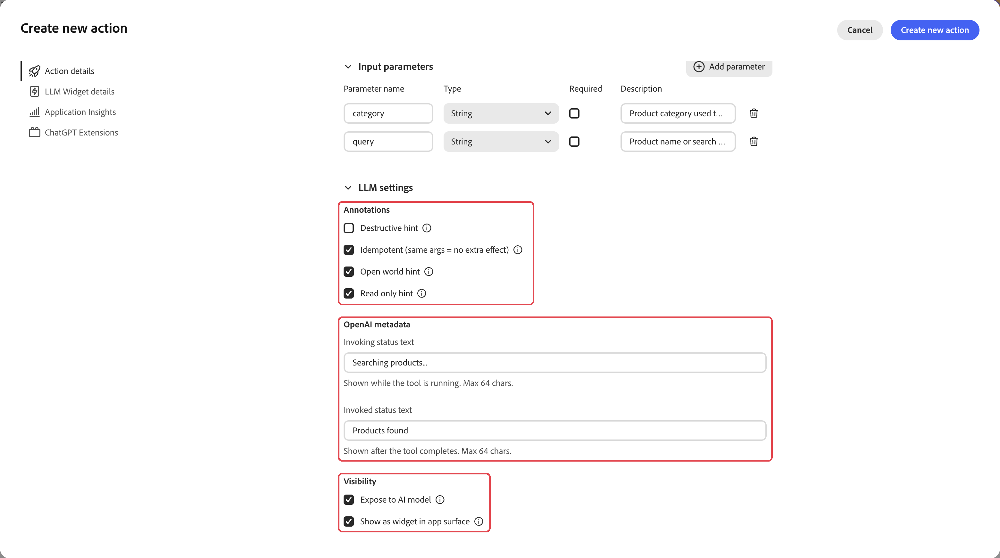

# Création d’une action à partir de zéro {#create-action-from-scratch}

>[!IMPORTANT]
>
>Les applications LLM sont disponibles pour tous les clients AEM Sites Cloud Service afin qu’ils puissent développer et gérer leurs propres applications. Une fois le comptage commencé, chaque appel d’application est comptabilisé dans les demandes de contenu AEM Sites du client. Adobe annoncera le taux de contrôle et la date de début avant que le contrôle ne prenne effet.

>[!NOTE]
>
>Ce guide suppose des connaissances de base d’Adobe Edge Delivery Services (EDS). Si vous découvrez EDS, lisez d’abord le [tutoriel de développement EDS](https://www.aem.live/developer/tutorial) et [Exploration des blocs](https://www.aem.live/docs/exploring-blocks) pour en savoir plus sur l’essentiel (les blocs, la fonction `decorate` et la structure du projet EDS) avant de connecter un widget.

Ajoutez une fonctionnalité que la plateforme n’a pas créée. Définissez l’action dans [!DNL LLM Apps], écrivez son gestionnaire dans le référentiel lié et ajoutez un widget si nécessaire.

**Dans ce guide :** Découvrez comment définir une action, implémenter son gestionnaire et connecter un widget facultatif. Testez l’action localement, déployez l’application et essayez l’action sur une plateforme LLM prise en charge.

Pour votre première application, commencez par [Configurer l’infrastructure](/help/guides/create-app.md), puis [Créer des actions](/help/guides/creating-actions.md). Le guide Créer des actions explique la génération automatique à partir d’un site web et la création manuelle.

## Avant de commencer

Vous avez besoin des éléments suivants :

- Une application LLM existante.
- Référentiel de gestionnaire lié.
- Un clone local du référentiel avec ses dépendances installées.
- Un projet EDS si l’action affiche un widget.
- Une API ou une source de données claire pour les résultats de production.

## Planifier l’action

Concevez chaque action autour d’une tâche utilisateur claire. Avant d’ouvrir l’interface utilisateur, définissez les éléments suivants :

- **Intention** — Ce que l&#39;utilisateur tente d&#39;accomplir.
- **Description** — Quand sélectionner l&#39;action.
- **Entrées** — informations minimales requises de l&#39;utilisateur.
- **Result** — Le texte et les données structurées renvoyés par le gestionnaire.
- **Comportement** — si l&#39;action lit des données, modifie des données ou appelle des systèmes externes.
- **Widget** — si le résultat nécessite une interface visuelle.

Par exemple, utilisez ce plan pour une action **Rechercher des produits** :

```text
Intent: Find products matching a category or search phrase
Inputs:
  category: optional string
  query: optional string
Result:
  content: text summary
  structuredContent: products and total count
Behavior: read-only, idempotent, open-world
Widget: product cards
```

Gardez les tâches liées mais différentes séparées. Utilisez des actions distinctes pour la recherche de produits et l’achat de produits, car les tâches comportent des entrées, des risques et des exigences de confirmation différents.

## Création des métadonnées d’action

Ouvrez l’application et sélectionnez **[!UICONTROL Actions]**, puis **[!UICONTROL Créer une action]**.

La boîte de dialogue **[!UICONTROL Créer une action]** comporte quatre onglets : **[!UICONTROL Détails de l’action]**, **[!UICONTROL Détails du widget LLM]**, **[!UICONTROL Informations sur l’application]** et **[!UICONTROL Extensions ChatGPT]**. La boîte de dialogue s’ouvre sur **[!UICONTROL Détails de l’action]**. L’éditeur d’action enregistrée utilise les mêmes onglets.

Les paramètres facultatifs **[!UICONTROL Extensions ChatGPT]** permettent aux utilisateurs d&#39;ouvrir l&#39;application directement, d&#39;utiliser une visionneuse de fichiers personnalisée ou de trouver des ressources dans le compositeur sur les clients pris en charge. Configurez-les une fois que l’action et le comportement de widget correspondants sont prêts. Voir [Configurer les extensions de ChatGPT](/help/guides/chatgpt-extensions.md).

### Saisir les informations d’action et les paramètres d’entrée


Sous **[!UICONTROL Informations sur l&#39;action]**, saisissez :

- **[!UICONTROL Nom de l&#39;action]** — un nom de tâche court, tel que *Rechercher des produits*.
- **[!UICONTROL Description]** — expliquez quand utiliser l&#39;action et ce qu&#39;elle renvoie.

La boîte de dialogue dérive un **[!UICONTROL identifiant de code]** du nom, tel que `search-products`. L’identifiant est fixe après création et doit être unique dans l’application. Utilisez l’identifiant exact du dossier de gestionnaire.

Une description utile est spécifique :

```text
Search the product catalog by category or keyword. Returns matching
products with their names, prices, categories, and image URLs.
```

Évitez les descriptions vagues telles que *Obtient des informations sur le produit*. La plateforme LLM utilise la description pour choisir entre les actions.

Sous **[!UICONTROL Paramètres d’entrée]**, sélectionnez **[!UICONTROL Ajouter un paramètre]** une fois pour chaque valeur acceptée par le gestionnaire. Pour chaque paramètre, saisissez :

- **[!UICONTROL Nom du paramètre]** : clé que le gestionnaire reçoit.
- **[!UICONTROL Type]** — Chaîne, Nombre, Entier, Booléen, Objet ou Fichier.
- **[!UICONTROL Obligatoire]** — si l&#39;action requiert la valeur.
- **[!UICONTROL Description]** — Comment extraire la valeur.

Pour **Rechercher Des Produits** :

```text
category
  Type: String
  Required: No
  Description: Product category used to narrow the catalog.

query
  Type: String
  Required: No
  Description: Product name or search phrase.
```

Utilisez des noms de paramètres stables. La modification d’un nom nécessite également la modification du gestionnaire et de ses tests.

### Configurer les paramètres LLM

Développez les **[!UICONTROL paramètres LLM]**. La section est réduite par défaut.



Sous **[!UICONTROL Annotations]**, sélectionnez uniquement les indications vraies pour l’action :

- **[!UICONTROL Indice destructeur]** — l&#39;action peut supprimer ou modifier définitivement des données.
- **[!UICONTROL Idempotent (mêmes arguments = aucun effet supplémentaire)]** — la répétition de la même requête a le même effet.
- **[!UICONTROL Indicateur de monde ouvert]** — l&#39;action communique avec des systèmes externes.
- **[!UICONTROL Conseil en lecture seule]** — l&#39;action ne modifie pas les données.

Par exemple, la recherche de produits est normalement en lecture seule, idempotent et open-world.

Sous **[!UICONTROL Métadonnées OpenAI]**, saisissez des messages courts affichés pendant l’exécution de l’action et une fois celle-ci terminée, jusqu’à 64 caractères chacun :

```text
Invoking status text: Searching products...
Invoked status text: Products found
```

Sous **[!UICONTROL Visibilité]** :

- **[!UICONTROL Exposer au modèle d’IA]** permet au modèle de sélectionner l’action.
- **[!UICONTROL Afficher comme widget dans la surface d’application]** affiche le widget configuré.

Visibility ne choisit pas le type de widget. Pour une action en mode texte uniquement, sélectionnez **[!UICONTROL Aucune interface utilisateur interactive]** sous **[!UICONTROL Détails du widget LLM]** > **[!UICONTROL Type de widget]**.

### Configurer les informations sur l’application {#configure-analytics}

Ouvrez **[!UICONTROL Application Insights]**. **[!UICONTROL L’option Collecter l’intention de l’utilisateur]** est sélectionnée par défaut : la plateforme LLM crée un résumé court et anonyme de ce que l’utilisateur tentait d’accomplir lors de l’exécution de l’action.

Si vous configurez votre propre [!DNL Adobe Analytics] ou [!DNL Customer Journey Analytics], l’intention de l’utilisateur y est également envoyée. Voir [Configurer Adobe Analytics et Customer Journey Analytics](/help/guides/analytics-setup.md).

Consultez les instructions situées sous la case à cocher, qui guident le résumé. Limitez-les à des intentions non sensibles et anonymes et décrivez votre collecte de données dans votre politique de confidentialité. Les instructions acceptent jusqu’à 2 000 caractères. Effacez **[!UICONTROL L&#39;intention de l&#39;utilisateur]** pour ne collecter aucun résumé.


Pour obtenir des définitions de champ complètes, voir [Champs d&#39;action et de widget](/help/reference/reference-docs.md).

## Configuration du widget

Ouvrez **[!UICONTROL Détails du widget LLM]**. Pour une action en texte uniquement, sélectionnez **[!UICONTROL Pas d’interface utilisateur interactive]** sous **[!UICONTROL Type de widget]** et ignorez les paramètres de widget restants.


Sous **[!UICONTROL Informations sur le widget]**, configurez :

- **[!UICONTROL Type de widget]** — sélectionnez **[!UICONTROL Bloc Edge Delivery Services]** pour un widget interactif.
- **[!UICONTROL Domaine du widget]** : origine du sandbox du widget. L’interface utilisateur l’identifie comme requise pour l’envoi de l’application et comme unique par application ; elle n’est pas identique à l’URL de la page EDS.
- **[!UICONTROL Description du widget]** : ce que dit le modèle après le rendu du widget, jusqu’à 512 caractères.

La description du widget diffère de la description de l’action :

- **Description de l’action** aide le modèle à décider quand appeler l’action.
- **Description du widget** mappée à `_meta["openai/widgetDescription"]` et résume ce que le composant rendu affiche, réduisant la narration répétée.

[!DNL LLM Apps] applique la description du widget en tant que métadonnées de composant. Ne renvoyez pas la description à partir du gestionnaire .

Développez les **[!UICONTROL URL de modèle]** et saisissez :

- **[!UICONTROL URL du script]** : point d’entrée du widget EDS.
- **[!UICONTROL URL du widget]** : page EDS publiée pour cette action.

Les URL standard sont les suivantes :

```text
Script URL:
https://main--<repo>--<owner>.aem.live/scripts/aem-embed.js

Widget URL:
https://main--<repo>--<owner>.aem.live/<widget-page>
```

Dans la configuration **[!UICONTROL CSP]**, ajoutez uniquement les origines dont le widget a besoin pour les ressources et les requêtes réseau. Un widget qui charge des ressources externes peut ne pas s’afficher si sa CSP est incomplète.


Si le projet EDS ou la page de widget n’existe pas encore, effectuez [Apportez votre propre projet EDS](/help/guides/bring-your-own-eds.md), puis revenez à l’action.

## Enregistrer l’action

Sélectionnez **[!UICONTROL Créer une action]**. L’action s’affiche sur la page Actions avec un badge **Non déployé**.

L’enregistrement crée les métadonnées, mais l’action a toujours besoin d’un gestionnaire.

Lorsque vous rouvrez l’action enregistrée, l’éditeur affiche les mêmes onglets. Pour enregistrer les modifications ultérieures, sélectionnez **[!UICONTROL Enregistrer les modifications]**.

## Mettre en œuvre le gestionnaire

Clonez le référentiel de gestionnaire lié et installez ses dépendances :

```bash
npm install
```

Créer :

```text
actions/
└── search-products/
    └── index.js
```

Le nom du dossier doit correspondre à l’identifiant de code de l’action affiché dans l’éditeur d’actions.

Pour le contrat de résultat complet et la relation gestionnaire-widget, consultez [Personnaliser un gestionnaire généré](/help/guides/customize-handler.md).

### Contrat de gestionnaire

Exportez une fonction asynchrone :

```javascript
module.exports = async (args) => {
  return {
    content: [
      { type: 'text', text: 'Response for the LLM platform.' }
    ],
    structuredContent: {
      // Data for the widget.
    }
  };
};
```

Le gestionnaire reçoit les paramètres définis dans l’interface utilisateur.

### Renvoyer `content`

La plateforme LLM lit `content` comme texte de remplacement :

```javascript
content: [
  { type: 'text', text: 'Found 3 matching products.' }
]
```

Renvoyer toujours `content` utile, même si l’action comporte un widget.

### Renvoyer `structuredContent`

Le widget utilise `structuredContent` en tant qu&#39;objet simple :

```javascript
structuredContent: {
  products: [
    { id: 'P-100', name: 'Product A', price: '$20' }
  ],
  total: 1
}
```

La forme doit correspondre à ce que le bloc EDS lit de `bridge.toolResult`.

### Connexion à une API

Conserver les appels API dans le gestionnaire côté serveur. Cet exemple appelle une API de produit publique. Configurez l’origine HTTPS de l’API dans une [variable d’application](/help/guides/app-variables.md) nommée `PRODUCT_API_ORIGIN`. L’exemple accepte les paramètres `query` et `category` définis ci-dessus, nécessite au moins un paramètre et ne nécessite pas d’informations d’identification.

```javascript
const { getVariable } = require('@adobe/llm-apps-runtime');

module.exports = async ({ query = '', category = '' } = {}, extra) => {
  const normalizedQuery = typeof query === 'string' ? query.trim() : '';
  const normalizedCategory = typeof category === 'string' ? category.trim() : '';
  if (typeof query !== 'string' || typeof category !== 'string'
      || (!normalizedQuery && !normalizedCategory)
      || normalizedQuery.length > 200 || normalizedCategory.length > 100) {
    return {
      isError: true,
      content: [{ type: 'text', text: 'Enter a valid product search.' }],
      structuredContent: { products: [], total: 0 }
    };
  }

  const apiOrigin = getVariable(extra, 'PRODUCT_API_ORIGIN');
  if (!apiOrigin) {
    throw new Error('Product API configuration is unavailable.');
  }

  const origin = new URL(apiOrigin);
  if (origin.protocol !== 'https:') {
    throw new Error('Product API configuration must use HTTPS.');
  }

  const url = new URL('/v1/products', origin);
  if (normalizedQuery) {
    url.searchParams.set('query', normalizedQuery);
  }
  if (normalizedCategory) {
    url.searchParams.set('category', normalizedCategory);
  }

  const response = await fetch(url, {
    signal: AbortSignal.timeout(8000)
  });

  if (!response.ok) {
    throw new Error('Product service request failed.');
  }

  const payload = await response.json();
  if (!payload || !Array.isArray(payload.products)
      || !payload.products.every((product) =>
        product
        && typeof product.id === 'string'
        && typeof product.name === 'string'
        && typeof product.price === 'string')) {
    throw new Error('Product service returned an unexpected response.');
  }

  const products = payload.products.map((product) => ({
    id: product.id,
    name: product.name,
    price: product.price
  }));

  return {
    content: [
      { type: 'text', text: `Found ${products.length} matching products.` }
    ],
    structuredContent: {
      products,
      total: products.length
    }
  };
};
```

Ne placez pas les informations d’identification d’API dans le code source, les métadonnées d’action, le JavaScript de widget, les journaux ou les erreurs rencontrées par l’utilisateur ou l’utilisatrice. L’interface utilisateur **[!UICONTROL Variables et secrets]** prend actuellement en charge uniquement les variables non sensibles, et non les secrets. Ne stockez pas de jeton API dans une variable. Si votre API en amont requiert des informations d’identification, organisez un mécanisme d’informations d’identification côté serveur approuvé avant de le connecter.

Pour le code de production, validez la réponse amont complète avant de mapper les champs approuvés dans `structuredContent`.

## Ajouter des tests de gestionnaire

Créez le test correspondant :

```text
test/
└── actions/
    └── search-products.test.js
```

Testez au moins :

- Entrée valide.
- Entrée manquante ou non valide.
- Résultats vides.
- Temporisation ou échec de l’API.
- Données API incorrectes.
- Forme `structuredContent` attendue par le widget.

Exécutez :

```bash
npm test
```

Pour la disposition du projet et les tests MCP locaux, consultez [Développement et test des gestionnaires locaux](/help/reference/development.md).

## Tester l’action localement

Exécutez :

```bash
npm run dev:local
```

Sans `actions.json` local, le serveur détecte le gestionnaire avec un minimum de métadonnées et aucune validation de schéma d’entrée.

Utilisez MCP Inspector ou `curl` pour :

1. Répertoriez les actions enregistrées.
2. Appelez la nouvelle action avec des arguments représentatifs.
3. Vérifier `content` et `structuredContent`.
4. Testez les requêtes non valides et vides.

## Connexion et test du widget

Si l’action comporte un widget :

1. Faites en sorte que le widget lise le `structuredContent` du gestionnaire.
2. Effectuez le rendu de valeurs externes avec des API DOM sécurisées telles que `textContent`.
3. Ajoutez les états de chargement, vide et d’erreur.
4. Prévisualisez la page EDS localement.
5. Vérifiez les URL CSP, CORS et de widget.

Voir [Apporter votre propre projet EDS](/help/guides/bring-your-own-eds.md).

## Déployer et tester

1. Validez et envoyez les modifications du gestionnaire et du widget.
2. [Déployez l’application](/help/guides/deploy-your-app.md) dans l’environnement intermédiaire.
3. Testez l&#39;application dans [ChatGPT](/help/guides/test-in-chatgpt.md) ou [Claude](/help/guides/test-in-claude.md).
4. Vérifiez la sélection de l’action avec les invites correspondant à l’action et les invites non liées qui ne l’appellent pas.
5. Une fois l’étape réussie, déployez en production.

Si des métadonnées existent sans gestionnaire correspondant, le déploiement enregistre l’action avec un stub par défaut. Ajoutez le gestionnaire avant de mettre l’action à la disposition des utilisateurs.
