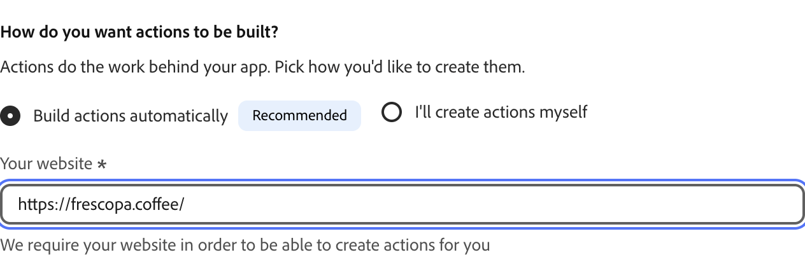
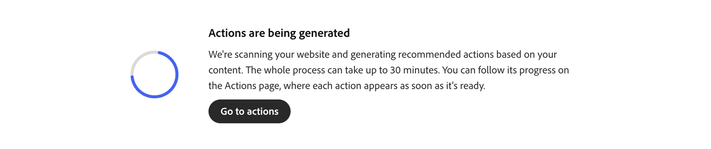
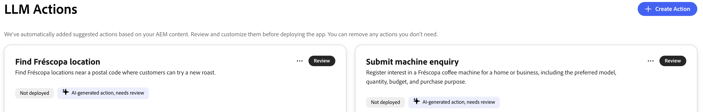
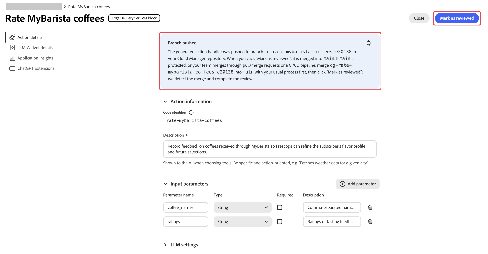

# Création d’actions {#creating-actions}

>[!IMPORTANT]
>
>Les applications LLM sont disponibles pour tous les clients AEM Sites Cloud Service afin qu’ils puissent développer et gérer leurs propres applications. Une fois le comptage commencé, chaque appel d’application est comptabilisé dans les demandes de contenu AEM Sites du client. Adobe annoncera le taux de contrôle et la date de début avant que le contrôle ne prenne effet.

Les actions sont les fonctionnalités que votre application offre dans une conversation LLM, telles que la recherche de produits, la vérification de la disponibilité ou la réservation d&#39;un service. Chaque gestionnaire d’action effectue la tâche, et un widget facultatif présente le résultat.

Après la [configuration de l’infrastructure](/help/guides/create-app.md), choisissez comment créer des actions à partir de la page de l’application. La génération automatique est disponible avec l&#39;infrastructure gérée [!DNL LLM Apps] et vos propres référentiels.

**Dans ce guide :** Découvrez comment générer des actions à partir de votre site web ou les créer vous-même. Pour la génération automatique, lancez le processus et passez en revue les résultats avant de déployer et de tester l’application.

## Choisir comment créer des actions

Ouvrez votre application. Si Adobe prépare toujours son infrastructure, attendez la fin de la configuration.

Dans la section **[!UICONTROL Actions]**, **[!UICONTROL Comment souhaitez-vous que les actions soient créées ?]** offre deux choix :

| Choix | Utilisez-le lorsque |
|---|---|
| **[!UICONTROL Créer automatiquement des actions]** | Vous souhaitez que la plateforme analyse votre site web et génère les actions suggérées, le code de gestionnaire, les tests et les widgets. Il s’agit du point de départ recommandé. |
| **[!UICONTROL Je créerai des actions moi-même]** | Vous devez définir chaque action et fournir vous-même sa mise en œuvre. |

Choisir l’infrastructure dans l’assistant de création d’application ne sélectionne aucune de ces options pour vous.

## Générer des actions à partir d’un site web {#generate-from-website}

1. Sélectionnez **[!UICONTROL Créer automatiquement des actions]**.
2. Dans **[!UICONTROL Votre site Web]**, entrez un site Web HTTPS public qui représente les produits, services ou tâches client de votre marque. Cet exemple utilise `https://frescopa.coffee/`.
3. Sélectionnez **[!UICONTROL Créer mes actions]**.

Utilisez un site web que vous êtes autorisé à analyser. Ne fournissez pas de site exposant des informations confidentielles ou dont l’accès est contrôlé.

La sélection de **[!UICONTROL Créer mes actions]** lance la génération ; la saisie de l’URL seule ne le fait pas. Vous n’avez pas besoin de recréer l’application ni de rouvrir l’assistant d’infrastructure.

### Suivre la progression de la génération

La page d&#39;application indique que **[!UICONTROL Actions sont en cours de génération]**. Sélectionnez **[!UICONTROL Accéder aux actions]** ou ouvrez **[!UICONTROL Actions]** dans la navigation pour suivre la progression.

L’interface utilisateur estime jusqu’à 30 minutes pour la génération. Quittez la page et revenez plus tard si nécessaire.

Pendant la génération, la plateforme :

1. Analyse le site web et identifie les tâches client pour l’application.
2. Crée des métadonnées d’action suggérées, y compris des descriptions et des paramètres d’entrée.
3. Génère des gestionnaires côté serveur et des tests dans le référentiel d’actions.
4. Génère des widgets dans le référentiel EDS.
5. Prépare les actions générées pour la révision.

Pendant que la plateforme analyse le site web, la page Actions affiche **[!UICONTROL Découverte des actions pour votre expérience de conversation]**. Les actions suggérées apparaissent lorsque la plateforme les détecte ; leurs aperçus de code et de widget peuvent encore être générés. Attendez la fin de la génération avant de passer en revue chaque action.

>[!IMPORTANT]
>
>Les gestionnaires générés utilisent initialement des données d’exemple représentatives. L’analyse de site web ne connecte pas automatiquement votre application aux API de production, aux inventaires dynamiques, aux services de paiement ou aux systèmes de réservation.

Si la génération signale un échec, lisez l&#39;erreur visible et vérifiez les [conseils de dépannage](/help/reference/troubleshooting.md). N’approuvez pas une action simplement pour contourner une erreur de génération.

## Vérifier les actions générées {#review-generated-actions}

Examinez chaque action suggérée avant le déploiement. Vérifiez qu’elle représente une tâche utile et que le comportement généré correspond à ce que vous souhaitez que l’application fasse.

1. Sur la page **[!UICONTROL Actions]**, sélectionnez **[!UICONTROL Vérifier]** pour une action prête.
2. Consultez la description de l’action, les paramètres d’entrée, les annotations, la visibilité et le gestionnaire généré.
3. Vérifiez la configuration du widget et l’aperçu, si l’action comporte un widget.
4. Inspectez le code et les tests générés. Avec l’infrastructure gérée [!DNL LLM Apps], la plateforme ouvre des demandes d’extraction ; avec vos propres référentiels, elle envoie une branche vers chaque référentiel. Vérifiez ce qu’est un exemple de comportement et ce qui doit être remplacé par des intégrations réelles.
5. Lorsque l’action est prête, sélectionnez **[!UICONTROL Marquer comme révisé]**.
6. Revenez à la liste d’actions et répétez l’opération pour les actions restantes.

L’éditeur d’actions enregistrées sépare **[!UICONTROL Détails de l’action]**, **[!UICONTROL Détails du widget LLM]**, **[!UICONTROL Informations sur l’application]** et **[!UICONTROL Extensions ChatGPT]**. Examinez les modifications apportées au widget et au gestionnaire générés dans leurs onglets respectifs.

Sélectionner **[!UICONTROL Marquer comme révisé]** fusionne les modifications générées s’il ne reste aucun bloqueur de fusion : extrayez les requêtes avec l’infrastructure gérée [!DNL LLM Apps], les branches avec vos propres référentiels. Si une demande d’extraction ouverte bloque la révision, résolvez le bloqueur et réessayez. N’approuvez pas une implémentation présentant des échecs de génération de code ou de fusion non résolus.

Avec vos propres référentiels, votre équipe peut également fusionner la branche avec son propre processus, tel qu’une demande d’extraction ou de fusion, avant de sélectionner **[!UICONTROL Marquer comme révisé]**. Si la plateforme ne peut pas fusionner la branche elle-même, par exemple parce que la branche cible est protégée ou que la branche est en conflit, la révision affiche la branche à fusionner dans quelle base. Fusionnez-le, puis sélectionnez à nouveau **[!UICONTROL Marquer comme révisé]**.

Après avoir examiné toutes les actions générées, la page Actions affiche **[!UICONTROL Toutes les actions sont examinées.]** Pour revenir à l’application, sélectionnez **[!UICONTROL Aller à la page de l’application]**.

La révision n’est pas un déploiement. Les actions ne sont pas disponibles via le serveur MCP de votre application tant que vous ne l’avez pas déployée.

## Création d’actions vous-même {#manual-actions}

Si vous préférez ne pas générer d’actions à partir d’un site web :

1. Dans le choix de création d&#39;actions de la page d&#39;application, sélectionnez **[!UICONTROL Je créerai des actions moi-même]**.
2. Sélectionnez **[!UICONTROL Je vais créer mes actions]**.
3. Sur la page Actions , sélectionnez **[!UICONTROL Créer une action]**.
4. Suivez [Créer une action à partir de zéro](/help/guides/create-action.md) pour définir les métadonnées, implémenter un gestionnaire et connecter un widget si nécessaire.

L&#39;infrastructure reste la même. Choisir la création manuelle ne crée pas de code de gestionnaire et ne connecte pas vos systèmes d’entreprise pour vous.

Ajoutez des actions manuelles après avoir examiné les actions générées automatiquement si nécessaire.

## Déployer et tester

Après avoir examiné le travail généré :

1. [Déployez l’application](/help/guides/deploy-your-app.md) dans **[!UICONTROL l’étape]**.
2. Testez-le dans [ChatGPT](/help/guides/test-in-chatgpt.md) ou [Claude](/help/guides/test-in-claude.md), à l’aide de l’URL du serveur MCP d’évaluation.
3. Invites de test correspondant à chaque action et invites sans rapport qui n’appellent pas cette action. Vérifiez à la fois la réponse textuelle et les interactions du widget.

Avant de mettre l’application à la disposition des clients, [personnalisez les gestionnaires](/help/guides/customize-handler.md) pour connecter vos API et [personnalisez les widgets](/help/guides/widgets.md). Testez l’application dans l’environnement d’évaluation pour confirmer qu’elle fonctionne comme prévu. Déployez en production uniquement après la réussite du test.
