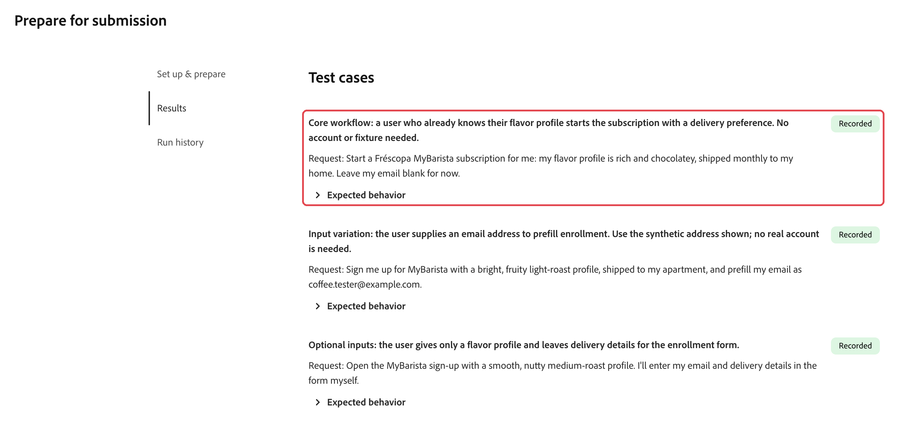

# Préparez votre application pour l&#39;envoi ChatGPT {#prepare-submission}

>[!IMPORTANT]
>
>Les applications LLM sont disponibles pour tous les clients AEM Sites Cloud Service afin qu’ils puissent développer et gérer leurs propres applications. Une fois le comptage commencé, chaque appel d’application est comptabilisé dans les demandes de contenu AEM Sites du client. Adobe annoncera le taux de contrôle et la date de début avant que le contrôle ne prenne effet.

Pour répertorier votre application dans le répertoire du plug-in [!DNL ChatGPT], téléchargez un package d’envoi vers OpenAI. [!DNL LLM Apps] vous aide à le préparer. Il crée le fichier ZIP du package à partir de votre application, envoie les requêtes de test à votre application déployée et enregistre les résultats afin que vous puissiez les vérifier. Vous téléchargez ensuite le package et terminez l’envoi sur le portail OpenAI.

**Dans ce guide :** Découvrez comment préparer un package d’envoi pour votre application dans [!DNL LLM Apps] et comment procéder ensuite sur le portail OpenAI.

>[!NOTE]
>
>[!DNL LLM Apps] n’envoie pas votre application à OpenAI. La vérification du développeur et du domaine, les tests de connexion, la révision et la publication ont lieu sur le portail OpenAI. Voir [Charger et envoyer votre plug-in](https://developers.openai.com/plugins/deploy/submission).

## Avant de commencer

- [Déployez votre application](/help/guides/deploy-your-app.md) sur **Production**. [!DNL LLM Apps] envoie ses requêtes de test à la version de production de votre application.
- Assurez-vous que les actions que vous souhaitez publier sont révisées et activées.
- Préparez le nom de votre éditeur ainsi que les URL de votre page d’assistance, de votre politique de confidentialité et des conditions d’utilisation.
- Préparez deux icônes : un logo et une icône de compositeur. Chaque doit être un fichier PNG non animé carré de 64 à 4 096 pixels par côté et ne doit pas dépasser 1 MiB. Utilisez uniquement des images que vous êtes autorisé à publier.
- Si votre application [authentifie les utilisateurs finaux](/help/guides/authentication.md), enregistrez un client OAuth pour [!DNL ChatGPT] dans votre fournisseur d’identité, sauf si votre fournisseur d’identité prend en charge l’enregistrement client dynamique (DCR) ou les documents de métadonnées d’ID client (CIMD).

## Ouvrir la préparation pour la soumission

Après le premier déploiement de votre application en production, la page de l’application affiche la vignette **[!UICONTROL Préparer l’envoi]** ci-dessous **[!UICONTROL Tester l’application]**.

Sélectionnez **[!UICONTROL Configurer]**. Plus tard, le bouton de la carte change pour afficher l’étape suivante, par exemple **[!UICONTROL Afficher la progression]** ou **[!UICONTROL Afficher les résultats]**.

La boîte de dialogue **[!UICONTROL Préparer l’envoi]** s’ouvre. Il comporte trois sections : **[!UICONTROL Configurer et préparer]**, **[!UICONTROL Résultats]** et **[!UICONTROL Historique d’exécution]**.

## Ajouter les détails de votre envoi

Dans **[!UICONTROL Configurer et préparer]** :

1. Sous **[!UICONTROL Éditeur et légal]**, saisissez **[!UICONTROL Nom de l&#39;éditeur]**, **[!UICONTROL URL de support]**, **[!UICONTROL URL de la politique de confidentialité]** et **[!UICONTROL URL des conditions d&#39;utilisation]**.
   - Pour **[!UICONTROL Nom de l’éditeur]**, saisissez le nom public que vous vérifierez en tant qu’éditeur dans le portail OpenAI.
   - Pour **[!UICONTROL URL d&#39;assistance]**, saisissez l&#39;URL d&#39;une page d&#39;assistance ou de contact. Une adresse e-mail n’est pas acceptée.
   - La politique de confidentialité doit décrire les données que votre application, authentification, widget et analyses collectent et utilisent.
2. Sous **[!UICONTROL Icônes approuvées]**, sélectionnez **[!UICONTROL Choisir le logo]**, puis **[!UICONTROL Choisir l’icône du compositeur]** et choisissez un fichier PNG pour chacune d’elles.
3. Si votre application utilise l’authentification, ouvrez l’**[!UICONTROL enregistrement du client OAuth]** et choisissez comment [!DNL ChatGPT] obtient un client OAuth. Choisissez uniquement une option prise en charge par votre fournisseur d’identité :
   - **[!UICONTROL Fourni]** - vous avez enregistré un client pour [!DNL ChatGPT]. Saisissez son **[!UICONTROL identifiant client enregistré]**. Ne saisissez pas votre identifiant client Adobe IMS.
   - **[!UICONTROL DCR]** - [!DNL ChatGPT] enregistre un client à l’aide de l’enregistrement client dynamique.
   - **[!UICONTROL CIMD]** - [!DNL ChatGPT] s’identifie avec un document de métadonnées d’ID client.

   [!DNL LLM Apps] ne demande jamais de secret client.
4. Vous pouvez éventuellement ouvrir **[!UICONTROL Détails d’envoi supplémentaires]** et saisir le texte de la liste, le nom et la version du package, les détails d’achat, l’URL de démonstration hébergée, les pays pris en charge et les notes de mise à jour. Si vous laissez un champ vide, [!DNL LLM Apps] crée un brouillon de texte là où il le peut. Tout ce qui ne peut pas être brouillon apparaît ultérieurement sous **[!UICONTROL Avant l&#39;envoi]**.
5. Sélectionnez **[!UICONTROL Enregistrer les modifications]**.

La préparation utilise uniquement les détails et les icônes que vous avez enregistrés.

>[!TIP]
>
>Les réviseurs OpenAI ont besoin d’une vidéo de démonstration de votre application, idéalement enregistrée dans [!DNL ChatGPT], à une URL qu’ils peuvent ouvrir. L&#39;enregistrement de test de [!DNL LLM Apps] est destiné à vos propres vérifications et ne remplace pas cette démonstration. Enregistrez la démonstration, chargez-la vers un emplacement accessible aux réviseurs et saisissez son URL dans **[!UICONTROL URL de démonstration hébergée]** avant de préparer le package.

## Préparer le package

Sous **[!UICONTROL Préparer votre package]**, vérifiez **[!UICONTROL Préparation]**. **[!UICONTROL Prêt pour la préparation]** signifie que vos détails enregistrés répondent aux exigences. Dans le cas contraire, la section répertorie les éléments manquants, tels qu’un détail obligatoire ou un déploiement en production réussi.

1. Lire **[!UICONTROL Que se passe-t-il lorsque vous préparez]** ? [!DNL LLM Apps] crée le package et envoie les requêtes de test à votre application déployée. Cela peut prendre plusieurs minutes et les requêtes de test peuvent apparaître dans les analyses de votre application.
2. Sélectionnez **[!UICONTROL Je comprends que cela appellera mon application déployée pour préparer les preuves de révision.]** case à cocher.
3. Sélectionnez **[!UICONTROL Préparer le package]**.

Pendant l’exécution de la préparation, la boîte de dialogue affiche **[!UICONTROL Préparation en cours]**. [!DNL LLM Apps] utilise votre application et les détails comme ils étaient lorsque vous avez sélectionné **[!UICONTROL Préparer le package]**.

Vous pouvez fermer la boîte de dialogue et revenir ultérieurement. La préparation se poursuit en arrière-plan et la carte de la page de l’application affiche **[!UICONTROL Préparation du package]** jusqu’à ce qu’elle se termine. Si la préparation échoue, vos informations enregistrées sont conservées.

## Consulter les résultats

Une fois la préparation terminée, ouvrez **[!UICONTROL Résultats]**. Le haut de la section résume le résultat. **[!UICONTROL La préparation requiert une attention]** signifie que [!DNL LLM Apps] a créé un brouillon de package, mais a détecté des problèmes que vous devez d&#39;abord résoudre, tels que des liens juridiques d&#39;espace réservé.

- **[!UICONTROL Package et rapport]** - sélectionnez **[!UICONTROL Télécharger le package]** pour obtenir le ZIP d’envoi, et **[!UICONTROL Télécharger le rapport]** pour obtenir le rapport de préparation. **[!UICONTROL Le package de téléchargement]** est disponible uniquement lorsque la préparation génère un package complet.
- **[!UICONTROL Consultez les enregistrements]** - sélectionnez **[!UICONTROL Télécharger l’enregistrement]** et regardez la vidéo pour confirmer que votre application se comporte comme prévu. Une vidéo peut inclure plusieurs cas de test.
- **[!UICONTROL Cas de test]** - Pour chaque cas de test, vérifiez la requête envoyée et son statut. Ouvrez **[!UICONTROL Comportement attendu]** pour voir ce que l’application doit faire. Certains cas de test demandent des éléments que votre application ne prend pas en charge. Pour cela, l’application doit refuser la demande sans appeler d’action.

Les enregistrements proviennent de l’environnement de test [!DNL LLM Apps]. Cela ne signifie pas que [!DNL ChatGPT] a vérifié votre application ou qu’OpenAI l’a approuvée.

**[!UICONTROL Avant envoi]** répertorie les détails que vous devez encore confirmer ou saisir, tels que la version du package, si l&#39;application implique des achats, l&#39;URL de démonstration hébergée, les pays pris en charge et les notes de mise à jour. En dessous de la liste, chaque vérification indique **RÉUSSITE**, **AVERTISSEMENT** ou **ÉCHEC**. Développez une vérification pour afficher les détails. Pour corriger un détail, sélectionnez **[!UICONTROL Mettre à jour les détails]**, enregistrez vos modifications et préparez à nouveau le package.

Si vous modifiez votre application ou vos détails après la préparation, **[!UICONTROL Les résultats]** affichent **[!UICONTROL L’application ou les entrées modifiées depuis cette exécution]**. Sélectionnez **[!UICONTROL Préparer à nouveau]** pour créer un nouveau package à partir de l’application actuelle et des détails. **[!UICONTROL L&#39;historique d&#39;exécution]** répertorie les préparations précédentes. L’ouverture d’une page ne modifie pas les détails enregistrés.

## Envoyer dans le portail OpenAI

Une fois le package terminé, téléchargez-le, puis suivez [Charger et envoyer votre plug-in](https://developers.openai.com/plugins/deploy/submission) dans la documentation OpenAI vers :

1. Chargez le fichier ZIP et résolvez les problèmes détectés par les contrôles automatiques.
2. Connectez votre serveur MCP et effectuez la vérification du domaine.
3. Saisissez les informations de révision, y compris les informations de connexion des réviseurs si votre application requiert une connexion, et envoyez l’application pour révision.
4. Publiez le module externe approuvé.

Pour vérifier votre domaine :

1. Après avoir chargé le package, copiez le jeton de défi affiché par le portail OpenAI.
2. Dans [!DNL LLM Apps], ouvrez les **[!UICONTROL paramètres]** > **[!UICONTROL envois]** de votre application.
3. Sous **[!UICONTROL Vérification du domaine]**, collez le jeton dans **[!UICONTROL Jeton de défi OpenAI]** et sélectionnez **[!UICONTROL Enregistrer]**.
4. [Déployez à nouveau votre application](/help/guides/deploy-your-app.md) en production. Le jeton n’est publié qu’après le prochain déploiement.
5. Revenez au portail OpenAI et effectuez la vérification.

[!DNL LLM Apps] sert le jeton à `/.well-known/openai-apps-challenge` sur le domaine de votre application, vous n’avez donc pas besoin de l’héberger vous-même.

### Conseils pour une révision en douceur

- **Vérifiez l&#39;authentification de chaque action.** Lorsque le portail OpenAI analyse votre serveur MCP, il appelle chaque action. Si une action est marquée comme nécessitant une authentification mais que l’appel ne peut pas être authentifié, l’analyse échoue. Vous devez ensuite corriger l’application, préparer un nouveau package et la charger à nouveau.
- **Accordez du temps pour la révision.** Après l’envoi, OpenAI examine votre application avant de la publier et envoie des commentaires par e-mail. Tenez compte de cette période lors de la planification de la date de publication.
- **Téléchargez un nouveau package lorsque les détails de la liste sont modifiés.** Après la publication, [!DNL ChatGPT] sélectionne automatiquement les modifications apportées à votre serveur MCP lors du redéploiement. Les modifications apportées aux détails de la liste ou aux autres métadonnées du package nécessitent un nouveau package. Préparez-le à nouveau dans [!DNL LLM Apps] et chargez-le sur le portail OpenAI.

## En relation

- [Déploiement de l’application](/help/guides/deploy-your-app.md)
- [Tester votre application LLM en tant que plug-in ChatGPT](/help/guides/test-in-chatgpt.md)
- [Configurer les extensions de ChatGPT](/help/guides/chatgpt-extensions.md)
