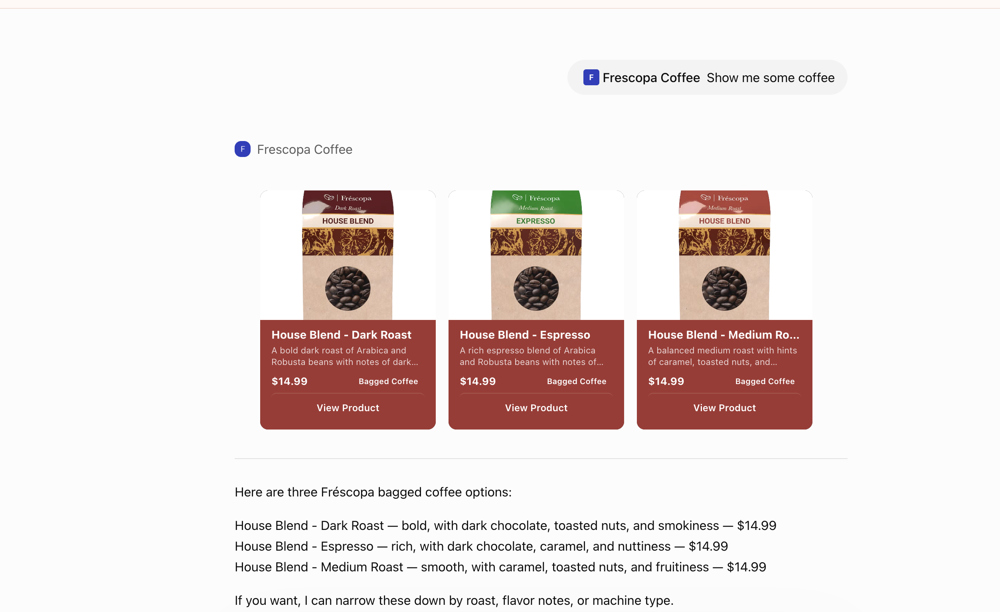

# Tester votre application LLM en tant que plug-in [!DNL ChatGPT] {#test-in-chatgpt}

>[!IMPORTANT]
>
>[!DNL Adobe LLM Apps] est actuellement dans Beta.
>
>Les fonctionnalités, les workflows et l’interface utilisateur affichés ici ne représentent pas nécessairement l’état final du produit. Pour rejoindre le Beta, envoyez un e-mail à llm-apps-beta@adobe.com.

Après le déploiement, votre application LLM expose une URL de serveur MCP. Ajoutez cette URL à [!DNL ChatGPT] en tant que plug-in, puis testez les actions et widgets générés.

**Dans ce guide :** Découvrez comment connecter votre application déployée à [!DNL ChatGPT] et tester ses actions et widgets dans une conversation. Actualisez la connexion après avoir modifié l’application.

## Planifier les exigences

Utilisez un compte et un espace de travail qui permettent d’ajouter des serveurs MCP personnalisés. Les contrôles de disponibilité et d’administration varient selon le compte et l’espace de travail. Consultez la documentation [Connexion et test du plug-in](https://developers.openai.com/plugins/deploy/connect-chatgpt) actuelle d’OpenAI.

## Vérifier l’accès aux serveurs MCP personnalisés

Ouvrez [Plug-ins ChatGPT](https://chatgpt.com/plugins) et vérifiez que votre compte permet d’ajouter un serveur MCP personnalisé. Si votre compte nécessite le mode Développeur, activez ce mode à l’aide des contrôles de votre compte. Si l’option de serveur MCP personnalisé est manquante ou bloquée, contactez votre administrateur d’espace de travail.

## Copier l’URL du serveur MCP

Dans [!DNL LLM Apps] :

1. Ouvrez la page Détails de l’application .
2. Rechercher **[!UICONTROL Tester l&#39;application]**.
3. Sous **[!UICONTROL Environnement d’évaluation]**, sélectionnez **[!UICONTROL Copier l’URL]**.

## Création du plug-in

1. Ouvrez [chatgpt.com/plugins](https://chatgpt.com/plugins).
2. Sélectionnez **+**, puis **[!UICONTROL Ajouter un serveur MCP personnalisé]**.
3. Configurez la connexion :
   - **[!UICONTROL Name]** : nom du plug-in.
   - **[!UICONTROL Description]** — facultatif.
   - Choisissez la méthode de connexion au serveur public et saisissez l’URL complète du serveur HTTPS MCP de votre application.
   - Sélectionnez la méthode d’authentification qui correspond à votre application. Pour une application publique dont l’authentification est désactivée, utilisez **[!UICONTROL Aucune authentification]** là où elle est proposée.

   >[!NOTE]
   >
   >Si vous avez activé l’authentification de l’utilisateur final, sélectionnez **[!UICONTROL OAuth]** lorsque chaque action est définie sur **[!UICONTROL Obligatoire]** ou **[!UICONTROL Mixte]** pour une combinaison d’actions publiques et protégées, où ces choix sont proposés. Voir [Authentifier les utilisateurs finaux avec votre propre fournisseur d&#39;identité](/help/guides/authentication.md).

4. Sélectionnez **[!UICONTROL Je comprends et souhaite continuer]**.
5. Sélectionnez **[!UICONTROL Créer comme plug-in]**.
6. Passez en revue les outils et les métadonnées découverts, puis installez ou connectez le plug-in obtenu. Effectuez la connexion si votre application l’exige.

OpenAI possède l’interface utilisateur de configuration et sa disposition peut varier en fonction du compte. Suivez les [instructions de connexion](https://developers.openai.com/plugins/deploy/connect-chatgpt) actuelles si les libellés affichés diffèrent.

## Tester le plug-in

1. Commencez une nouvelle conversation.
2. Saisissez `@` dans le champ d’invite et sélectionnez le module externe installé.
3. Posez une question correspondant à l’une des actions générées. Par exemple : *Montrez-moi du café.*

Vérifiez que :

- [!DNL ChatGPT] appelle l’action attendue.
- Le widget affiche les exemples de données attendus.
- La réponse textuelle correspond au widget.
- Les contrôles de widget fonctionnent comme prévu.

Testez également une entrée non valide, des résultats vides, des invites non liées qui n&#39;appellent pas l&#39;application et des actions qui modifient les données. Examinez chaque invite de confirmation et d’authentification plutôt que d’approuver toutes les demandes à l’avance.

### Tester les extensions facultatives

Si vous avez configuré les [extensions ChatGPT](/help/guides/chatgpt-extensions.md), essayez chaque point d&#39;entrée, chaque paramètre d&#39;affichage et chaque recherche de compositeur sélectionnés, et comparez le résultat avec le comportement attendu dans ce guide. Si plusieurs points d’entrée utilisent le même widget, testez chaque méthode sélectionnée pour l’ouvrir, y compris sans fichier pour Global ou Thread. La connexion à l’application ou l’appel d’une action dans une conversation ne vérifie pas ces fonctionnalités. Vérifiez d’abord les [exigences du client](/help/guides/chatgpt-extensions.md#before-you-begin) : les points d’entrée de fichier nécessitent un bureau et la prise en charge web de l’extension OpenAI exclut le ChatGPT classique.

## Actualiser après les modifications de l’application

Après avoir modifié les descriptions des actions, les entrées, l’authentification ou la configuration de widget :

1. Déployez l’application mise à jour dans le même environnement.
2. Ouvrez sa connexion sur [Plug-ins ChatGPT](https://chatgpt.com/plugins) et sélectionnez **[!UICONTROL Actualiser]**.
3. Vérifiez que les actions annoncées ont changé.
4. Démarrez une nouvelle conversation et répétez les tests concernés.

## Prochaines étapes

- [Personnaliser les widgets générés](/help/guides/widgets.md).
- [Créer une action à partir de zéro](/help/guides/create-action.md).
